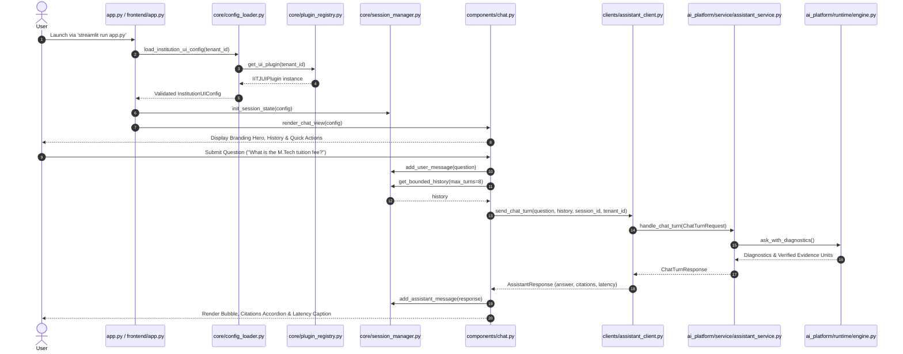

# Architectural Specification — Modular Plugin-Based Frontend Architecture

**Date**: October 18, 2026  
**Author**: Senior Staff AI Engineer & Application Architect  
**Target Repository**: IIT Jodhpur & Reusable Academic Core RAG Platform  
**Target Runtime**: Streamlit 1.66.0, Python 3.14.2  
**Status**: Production-Ready Architectural Reference

---

## 1. Architectural Motivation

Prior to Milestone 1, the Streamlit interface (`UI/` and `app.py`) was coupled with legacy backend database modules (`backend/authentication.py`, `backend/persistence.py`, `backend/conversation_session.py`), requiring active Supabase connections or falling back to ad-hoc local modes. Furthermore, campus navigation was hardcoded for a single institution, making multi-college onboarding difficult.

Milestone 1 introduces a clean, separate, plugin-based frontend under `frontend/` that:
1. **Unifies Entry Execution**: `streamlit run app.py` launches the modular frontend via a thin, contract-compliant launcher.
2. **Preserves Legacy Reference**: Leaves the older `UI/` untouched for reference.
3. **Implements an Extensible Plugin Architecture**: Decouples shared UI presentation components from institution-specific branding and optional features.
4. **Connects to Canonical AI Platform**: Interfaces exclusively through [ai_platform/service/assistant_service.py](file:///Users/bhuvanachandra/Desktop/RAG_Chatbot/ai_platform/service/assistant_service.py) via `ChatTurnRequest` and `ChatTurnResponse`.
5. **Enforces Strict Architectural Hygiene**: Contains zero imports of legacy RAG algorithm modules and zero mandatory Supabase dependencies.

---

## 2. Directory and Package Layout

```
frontend/
├── __init__.py                  # Exposes run_app()
├── app.py                       # Main Streamlit application orchestrator
├── styles.py                    # Design tokens and custom CSS injection
├── core/
│   ├── models.py                # Typed dataclasses (InstitutionUIConfig, ChatMessage, Conversation)
│   ├── config_loader.py         # Tenant resolution, schema validation & AI profile cross-check
│   ├── plugin_registry.py       # Plugin registry protocol and auto-discovery
│   └── session_manager.py       # Ephemeral Streamlit session state & bounded history windowing
├── clients/
│   └── assistant_client.py      # Boundary adapter to canonical handle_chat_turn()
├── components/
│   ├── chat.py                  # Main page view, prompt handling & spinner coordination
│   ├── sidebar.py               # Sidebar branding, "New Chat" & conversation switcher
│   ├── messages.py              # Message bubbles, latency tags & safe refusal badges
│   ├── sources.py               # Expandable verified citations accordion drawer
│   ├── quick_actions.py         # Configurable suggested inquiry cards & campus map trigger
│   └── structured_cards.py      # Structured navigation (with Google Maps link) & emergency cards
└── plugins/
    ├── iitj/
    │   ├── __init__.py
    │   └── plugin.py            # IIT Jodhpur UI presentation plugin
    └── template/
        ├── __init__.py
        └── plugin.py            # Minimal onboarding template for future colleges
```

---

## 3. Component Interaction Workflow



---

## 4. Architectural Boundaries and Invariants

### 4.1 Boundary 1: Shared UI vs. Institution Plugins
- Generic presentation components (`components/*.py`) are strictly parameter-driven and accept `config: InstitutionUIConfig`.
- No IITJ-specific string literals, colors, or file paths are hardcoded in `frontend/components/` or `frontend/core/`.
- Future institutions register a plugin without altering any component in `components/`.

### 4.2 Boundary 2: Presentation Layer vs. Canonical Service
- `frontend/clients/assistant_client.py` is the **only module** in the frontend that imports from `ai_platform.service.assistant_service`.
- The frontend client maps UI data types into `ChatTurnRequest` and returns a typed `AssistantResponse`.
- Neither the frontend nor the client implements retrieval, ranking, vector embedding, or LLM generation.

### 4.3 Boundary 3: Ephemeral Sessions vs. Future Persistence
- `frontend/core/session_manager.py` maintains conversations in memory via `st.session_state`.
- Each conversation receives a distinct UUID (`chat_<uuid>`), strictly preventing cross-chat history leakage.
- Database imports (`supabase`, `psycopg2`) are barred from `frontend/`, enabling local demonstrations without cloud credentials.
- A future persistence bridge will write through from `session_manager.py` to `application/persistence/` without modifying UI layout components.

---

## 5. UI Design and Visual Styling Tokens

The visual styling is managed in [frontend/styles.py](file:///Users/bhuvanachandra/Desktop/RAG_Chatbot/frontend/styles.py), enforcing:
- **Responsive Layout**: Sidebar width locked at 320px with subtle borders. Header transparent with compact top padding.
- **Brand Hero Card**: Glassmorphic container with 12px border radius, subtle blur, and institutional primary/accent color gradients.
- **Quick Action Grid**: 2-column responsive layout with hover elevation and accent border highlights.
- **Structured Cards**: Dedicated callout containers for campus navigation (with direct `st.link_button` to Google Maps) and emergency services.
- **Citation Accordion**: Collapsible drawer with green accent borders showing document names, headings, and excerpts.
- **Metadata Badges**: Discreet badges for latency timing (`⏱️ 1.45s`) and safe abstention (`🛡️ Safe Abstention`).
