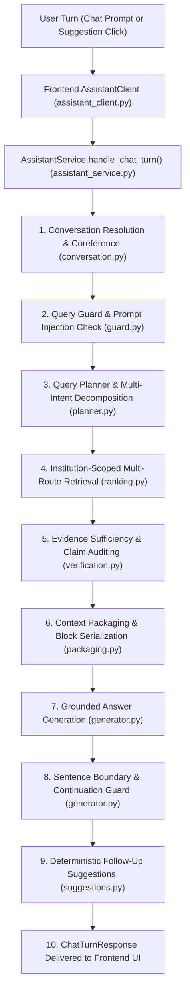

# Prompt & Conversation Flow Audit

**Date**: October 18, 2026  
**Auditor**: Senior Staff AI Engineer specializing in RAG systems, prompt engineering, conversational retrieval, and Streamlit application architecture  
**Scope**: Canonical AI Platform (`ai_platform/`) and Modular Frontend (`frontend/`)  
**Status**: Production Audit & Hardening Reference

---

## 1. Executive Summary

This audit examines the complete lifecycle of natural language prompts across the canonical RAG platform and frontend integration. It details how user queries, conversational context, retrieved evidence, and institutional boundaries are translated into model prompts and system directives.

The audit identifies the concrete failure modes that resulted in mid-sentence answer truncation (e.g., *"The NOC should either state that the employer has no objection to"*), context leakage across topic boundaries, and incomplete attribute transfer in conversational coreference resolution. It also documents the hardening measures implemented in Milestone 1.1, ensuring prompt discipline without introducing new prompt frameworks or destabilizing production contracts.

---

## 2. End-to-End Conversation & Prompt Pipeline



---

## 3. Detailed Prompt Inventory & Analysis

### 3.1 Conversation Resolution & Query Rewriting

- **File & Function**: `ai_platform/core/conversation/conversation.py` -> `resolve_conversation(messages, query, llm, ...)` & `_CONVERSATION_PROMPT`
- **Inputs**:
  - `history_text`: Recent conversation turns bounded by window size (last 3-5 turns), formatted as `user: <msg>\nassistant: <msg>`.
  - `query`: Current raw user message (e.g., *"What about sponsored students?"*).
- **Expected Output**:
  - Strict JSON object:
    ```json
    {
      "resolved_query": "<fully standalone search query preserving entities and attributes>",
      "intent": "academic_query|admission|fee|leave|rule|other",
      "active_entity": "<programme/course/category or null>",
      "active_topic": "<tuition fee|eligibility|leave rules|etc.>",
      "is_followup": true|false
    }
    ```
- **Downstream Consumer**: `ai_platform/runtime/engine.py` / `ai_platform/service/assistant_service.py` -> consumed by query planning, intent classification, and multi-route retrieval.
- **Known Failure Modes**:
  1. *Attribute Dropping*: For follow-ups like *"What about sponsored students?"*, previous resolution only preserved the programme (`M.Tech`) but dropped the antecedent query attribute (`tuition fee`), resulting in general admission queries rather than fee searches.
  2. *Topic Leakage*: When a user abruptly shifted topics (e.g. from PhD leave rules to hostel accommodation), previous heuristic anchor candidates remained bound to the old entity (`Ph.D.`), polluting unrelated search queries.
  3. *Unresolved Corrections*: Explicit corrections (e.g. *"No, I meant MBA, not M.Tech"*) were treated as ambiguous or failed to substitute the target entity.
- **Contradictions / Duplications**:
  - System prompt previously lacked explicit rules for attribute preservation (fees, stipends, quotas, leave rules) and entity replacement on user correction.
- **Institution-Specific Details**: None embedded in shared code. Generic categories (degree programmes, categories, leaves) are handled without hardcoding IITJ-specific facts.
- **Milestone 1.1 Hardening**:
  - Enhanced `_CONVERSATION_PROMPT` with explicit instructions:
    * "When the follow-up asks about a different student category or condition, preserve the antecedent query attribute (e.g. tuition fee, leave quota, eligibility criteria)."
    * "If the user corrects an earlier statement (e.g., 'No, I meant MBA'), update the active entity accordingly."
    * "If the user explicitly switches topics, do not force the previous entity into the resolved query."
  - Added deterministic fallback `_extract_query_attribute()` to guarantee attribute inheritance even under lightweight local LLM execution.

---

### 3.2 Query Planning & Multi-Intent Decomposition

- **File & Function**: `ai_platform/core/query/planner.py` -> `build_query_plan(query, ...)` & `QUERY_PLANNER_SYSTEM_PROMPT`
- **Inputs**: Standalone `resolved_query`, active institution context, schema metadata.
- **Expected Output**: Structured `QueryPlan` with discrete sub-intents, routing keys (e.g. `academic_regulations`, `fee_structure`, `emergency`), and priority weights.
- **Downstream Consumer**: Canonical retrieval orchestrator (`ai_platform/core/retrieval/ranking.py`).
- **Known Failure Modes**:
  - Over-decomposition: Splitting tightly coupled single-intent questions into redundant multi-route searches.
  - LLM hallucination of ungrounded sub-queries when input text is terse.
- **Contradictions / Duplications**: Cleanly partitioned; rule-based fast path intercepts high-confidence single intents before LLM planner invocation.
- **Institution-Specific Details**: Institution identity is passed dynamically via parameters; no institutional rules are hardcoded in the core planner prompt.

---

### 3.3 Query Guard & Prompt Injection Defense

- **File & Function**: `ai_platform/core/query/guard.py` -> `evaluate_query_guard(query, context)`
- **Mechanism**: Deterministic regex pattern matching and structural anomaly detection (No LLM prompt).
- **Inputs**: Raw query string and conversational turn history.
- **Expected Output**: `GuardVerdict(is_safe: bool, violation_type: Optional[str], safe_response: Optional[str])`.
- **Downstream Consumer**: Execution short-circuit in `engine.py` / `assistant_service.py`. Safe refusal is triggered immediately if prompt injection, jailbreak attempts, or out-of-scope system prompts leakage is detected.
- **Known Failure Modes**: Over-eager matching on academic terms containing substrings like "eval", "system", or "override". Mitigated by strict token boundary checks (`\b`).

---

### 3.4 Evidence Sufficiency & Claim Auditing

- **File & Function**: `ai_platform/core/evidence/verification.py` -> `verify_evidence_sufficiency(query, candidate_docs, ...)`
- **Mechanism**: Lexical overlap, semantic relevance filtering, threshold-based citation alignment, and passage deduplication.
- **Inputs**: Retrieved candidate documents and resolved search query.
- **Expected Output**: List of authorized `VerifiedPassage` items, each with document ID, section name, exact verified text, and relevance score.
- **Downstream Consumer**: Context packaging engine (`packaging.py`).
- **Failure Modes**: Low recall on complex cross-document queries when individual chunk scores fall just below the threshold. Handled by fallback to multi-intent union retrieval.

---

### 3.5 Context Packaging & Block Serialization

- **File & Function**: `ai_platform/core/evidence/packaging.py` & `ai_platform/core/retrieval/final_context_builder.py` -> `format_evidence_blocks(passages)`
- **Inputs**: Verified passages.
- **Expected Output**: Structured Markdown evidence blocks passed into the LLM system/human prompt:
  ```markdown
  [Document 1: MTech_Ordinances.pdf | Section: Fee Structure]
  Tuition fee for regular full-time M.Tech. students is Rs. 15,000 per semester...

  [Document 2: Sponsored_Category_Rules.pdf | Section: Financial Guidelines]
  Sponsored candidates are not eligible for MoE fellowship. Tuition fee for sponsored M.Tech. is Rs. 35,000 per semester...
  ```
- **Downstream Consumer**: `ai_platform/core/answering/generator.py` (`build_answer_prompt`).
- **Prompt Space Management**: Dynamically trims lowest-scoring chunks to respect context window limits while preserving at least top-ranked verified evidence.

---

### 3.6 Answer Generation

- **File & Function**: `ai_platform/core/answering/generator.py` -> `generate_answer()` & `_DEFAULT_SYSTEM_INSTRUCTIONS`
- **Inputs**:
  - `question`: Resolved user inquiry.
  - `context`: Formatted verified evidence blocks.
  - `institution_name`: Active college display name.
- **Expected Output**: Grounded, well-structured answer with Markdown formatting, clean sentence termination, and citations in format `[DocID, Section]`.
- **Root Cause of Mid-Sentence Truncation**:
  1. *Token Limit Undersizing*: `ANSWER_LLM_MAX_OUTPUT` was capped at 256 tokens in `ai_platform/runtime/llm.py`. For complex multi-clause policies (such as NOC sponsorship rules requiring multiple conditions), 256 tokens was insufficient.
  2. *Ignored Termination Reason*: Ollama returned `done_reason: "length"`, but the generator did not inspect this signal, delivering half-generated sentences directly to the caller.
  3. *Unstructured Prompt Tone*: Prompt did not penalize unclosed thoughts or mandate clean sentence ending when token budgets ran tight.
- **Milestone 1.1 Prompt & Engine Hardening**:
  - **Prompt Hardening**:
    ```
    - Structure complex answers with clear markdown headings, bullet points, or numbered steps.
    - Present answers in clear, natural language rather than copying raw document fragments verbatim.
    - Always finish every sentence with proper terminal punctuation (. ? !).
    - If you are approaching the end of your response or token budget, complete your current thought cleanly rather than starting a new clause or sentence you cannot finish.
    - If evidence is partial, state what is known from the official documents and cleanly indicate what specific details are not specified.
    ```
  - **Runtime Parameter Increase**: Increased `ANSWER_LLM_MAX_OUTPUT` from 256 to 512 tokens.
  - **Continuation & Sentence Guard**: Added `finish_reason` inspection, bounded single-pass continuation when `done_reason == "length"`, and terminal sentence boundary trimming to prevent trailing incomplete clauses.

---

### 3.7 Follow-Up Suggestion Generation

- **File & Function**: `ai_platform/service/suggestions.py` -> `generate_follow_up_suggestions()`
- **Mechanism**: Deterministic, zero-LLM candidate extraction.
- **Inputs**: `question`, `answer`, `evidence`, `entity`, `topic`, `institution_id`.
- **Expected Output**: List of 0 to 3 concise, highly relevant, natural follow-up question strings.
- **Downstream Consumer**: `ChatTurnResponse.suggested_questions` -> rendered as interactive action buttons in Streamlit `frontend/components/messages.py`.
- **Design Decisions**:
  - **Zero Model Calls**: Avoids adding 1-3 seconds of LLM inference latency to chat turns.
  - **Suppression on Refusals**: Returns an empty list (`[]`) whenever safe refusals, engine errors, or empty evidence states occur.
  - **Grounded Heuristics**: Builds suggestions directly from active entities (`M.Tech`, `Ph.D.`), topics (`tuition fee`, `leave rules`), and retrieved section headers.

---

## 4. Prompt Audit Matrix

| Component | Responsible File | Inputs | Downstream Consumer | Failure Mode Identified | Milestone 1.1 Resolution |
|---|---|---|---|---|---|
| **Conversation Resolver** | `conversation.py` | Turn history (last 3-5), latest query | Retrieval / Query Planner | Dropped query attribute on category follow-ups; entity leakage on topic shift | Updated prompt rules + deterministic attribute preservation fallback |
| **Query Guard** | `guard.py` | Raw query string | Engine / Assistant Service | Potential false positives on academic "eval" keywords | Boundary-isolated regex patterns |
| **Query Planner** | `planner.py` | Standalone query | Multi-route retrieval | Over-decomposition of simple factual queries | Fast-path heuristic classification |
| **Evidence Verification** | `verification.py` | Query + candidate docs | Context Packaging | Low recall on marginal threshold passages | Multi-intent union fallback |
| **Context Packaging** | `packaging.py` | Verified passages | Answer Generator | Chunks exceeding prompt window | Scored truncation preserving top evidence |
| **Answer Generation** | `generator.py` | Packaged evidence + Question | Assistant Service & UI | Mid-sentence truncation at 256 tokens (`done_reason: length`) | Raised tokens to 512 + continuation guard + prompt termination rules |
| **Follow-Up Suggestions** | `suggestions.py` | Turn metadata + evidence | Frontend Chat UI | Risk of hallucinating ungrounded next topics | Zero-LLM deterministic extraction from verified evidence |

---

## 5. Architectural Invariants Preserved

1. **Prompt Isolation**: Shared core prompts contain zero hardcoded college facts (no IITJ-specific course names or regulations in generic prompt templates).
2. **Grounding Priority**: Answers must strictly cite authorized verified evidence; no conversational text alone may serve as an authoritative factual source.
3. **Fail-Safe Abstention**: Queries with no verified evidence safely abstain rather than hallucinating answers to appear complete.
4. **Latency Budget**: Zero additional model calls introduced for follow-up suggestions, maintaining sub-second overhead for post-answer processing.
