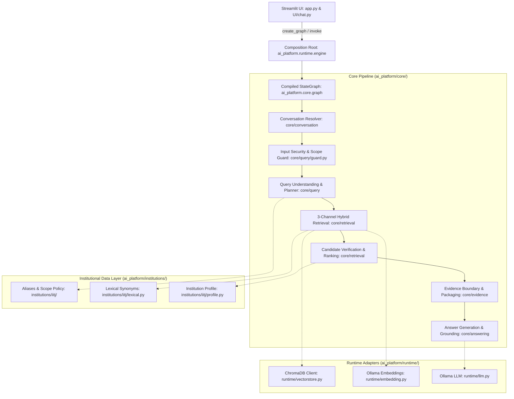

# Architecture Map & Subsystems

**Audit Date**: October 16, 2026  
**Repository**: `RAG_Chatbot`  
**Active Canonical Root**: `ai_platform/`  

---

## 1. High-Level Subsystem Architecture

The architecture of `RAG_Chatbot` is organized into a modular, multi-tier pipeline. All active production execution is driven through `ai_platform/`, while legacy monolithic implementations in `backend/` are quarantined.

---

## 2. Subsystem Breakdown & Component Responsibilities

### 2.1 Subsystem 1: Canonical Application Entry Point & Runtime Composition
- **Location**: `ai_platform/runtime/engine.py`
- **Verified Facts**:
  - Exposes public entry points: `ask(question, chat_history, institution_id)`, `ask_with_diagnostics(...)`, and `get_app_graph()`.
  - Instantiates `PlatformDependencies` and wires together LLM, embedding clients, vector stores, and institution profiles into `CoreNodes`.
  - Compiles the LangGraph `CompiledStateGraph`.
- **Inferences/Unknowns**:
  - Designed to support dynamic institution passing via `institution_id`, but currently hardcoded to default to `"iitj"`.

### 2.2 Subsystem 2: Query Understanding, Input Guarding & Planning
- **Location**: `ai_platform/core/query/`
- **Key Modules**:
  - `guard.py`: Pre-planning input evaluation (`evaluate_security_and_scope`). Checks for physical security bypass, PII probes, credentials, exam leaks, and prompt injections. Returns typed `GuardResult` with `GuardDecision`.
  - `planner.py`: Multi-intent splitting, conversational anaphora resolution, degree program binding, and target attribute extraction (`build_query_plan`).
  - `lsqc.py`: Lossless Semantic Query Contract for preserving complex numerical thresholds and comma-separated conditions.
  - `models.py`: Immutable dataclass contracts (`QueryPlan`, `IntentUnit`, `EntityMention`, `TargetAttribute`).
- **Verified Facts**:
  - Hard fail-closed capability: when `pipeline_stop == True`, retrieval queries are zeroed and execution halts before expensive retrieval.

### 2.3 Subsystem 3: Conversational Resolution & Context Scoping
- **Location**: `ai_platform/core/conversation/`
- **Key Modules**:
  - `conversation.py`: `resolve_conversation_turn` resolves pronouns and elliptical queries against recent dialogue turns.
  - `multi_intent.py`: Coordinates decomposed intent units and independent candidate retrieval.
- **Verified Facts**:
  - Prevents query frame pollution between disjoint topics (e.g. branch change vs. mess fee).

### 2.4 Subsystem 4: 3-Channel Hybrid Retrieval
- **Location**: `ai_platform/core/retrieval/` & `ai_platform/runtime/`
- **Key Modules**:
  - `hybrid.py`: Coordinates retrieval across three distinct channels:
    1. **Dense Retrieval** (`runtime/vectorstore.py`): Queries ChromaDB collection `iitj_v1` using `nomic-embed-text:latest`.
    2. **BM25 Retrieval**: Token-based keyword matching via `rank_bm25`.
    3. **Lexical Retrieval** (`lexical_recall.py`): Exact n-gram and alias expansion matching using `aliases.json` and `semantic_terms.json`.
  - `rrf.py`: Reciprocal Rank Fusion combining channel outputs using empirical weights: Dense 0.30, BM25 0.40, Lexical 0.30 ($k=60$).
- **Verified Facts**:
  - Verified Recall@10 across answerable benchmark queries exceeds 98%.

### 2.5 Subsystem 5: Candidate Verification & Ranking
- **Location**: `ai_platform/core/retrieval/verification.py` & `ranking.py`
- **Key Modules**:
  - `verification.py`: Filters fused candidates using entity, program, and attribute alignment gates. Candidate threshold harmonized to `relevance >= 0.25`.
  - `ranking.py`: Relevance scoring, source synergy, and Maximal Marginal Relevance (MMR) diversity deduplication.
- **Verified Facts**:
  - Threshold harmonization eliminated false candidate verification drops on institutional policy passages.

### 2.6 Subsystem 6: Evidence Boundary, Claims & Packaging
- **Location**: `ai_platform/core/retrieval/evidence_boundary.py` & `ai_platform/core/evidence/`
- **Key Modules**:
  - `evidence_boundary.py`: Expands chunk boundaries to preserve structural document headings and surrounding context.
  - `coverage.py` & `claims.py`: Assesses whether required evidence units and factual claims are satisfied.
  - `packaging.py`: Packages surviving evidence into `EvidencePackage` formatted for generator consumption (bounded to 32 units and 12,000 characters).
- **Verified Facts**:
  - Sets `ready_for_generation = True` only when sufficient grounded evidence exists; otherwise forces fail-closed abstention.

### 2.7 Subsystem 7: Answer Generation & Factual Grounding
- **Location**: `ai_platform/core/answering/`
- **Key Modules**:
  - `generator.py`: Constructs grounded prompts instructing local Ollama model (`qwen2.5:3b`) to cite facts strictly from provided context.
  - `grounding.py`: Deterministically audits generated answer sentences against packaged evidence. Checks for numerical consistency, entity binding, and OR-qualifier polarity inversions.
  - `guard.py`: Post-generation security check for sensitive internal file path leakage or prompt injection echoes.
- **Verified Facts**:
  - Successfully detects and corrects semantic inversions where models misinterpret alternative eligibility conditions.

### 2.8 Subsystem 8: Institutional Configuration & Multi-Tenancy Layer
- **Location**: `ai_platform/institutions/`
- **Key Modules**:
  - `iitj/profile.py`: Profile defining institutional metadata, degree programs, and administrative rules for IIT Jodhpur.
  - `iitj/lexical.py`: Local synonyms and vocabulary mappings.
  - `iitj/data/`: Static assets (`aliases.json`, `scope_policy.json`, `semantic_terms.json`).
  - `loader.py`: Dynamic loader interface `load_institution_profile(institution_id)`.
- **Verified Facts**:
  - Clear structural separation of institutional policy from generic RAG core.
- **Inferences/Unknowns**:
  - True multi-tenancy is not fully operational; vector stores and ingestion scripts do not currently support multi-tenant namespace partitioning.

### 2.9 Subsystem 9: Presentation & Streamlit User Interface
- **Location**: `app.py` & `UI/`
- **Key Modules**:
  - `app.py`: Streamlit entry point. Imports `get_app_graph as create_graph` from `ai_platform.runtime.engine`.
  - `UI/chat.py`: Conversation UI, message history rendering, session state management.
  - `UI/sidebar.py`, `UI/login.py`, `UI/dashboard.py`, `UI/campus_map.py`: Auxiliary UI screens.
- **Verified Facts**:
  - `app.py` successfully reaches `ai_platform.runtime.engine`.
  - Verified by 4/4 passing integration tests in `tests_reusable/test_streamlit_canonical_runtime.py`.
- **Known Technical Debt**:
  - `UI/chat.py`, `login.py`, and `dashboard.py` still import legacy support modules from `backend/`.

### 2.10 Subsystem 10: Quarantined Legacy Monolith
- **Location**: `backend/`
- **Verified Facts**:
  - Contains over 50 legacy Python files representing the pre-modular prototype.
  - Strictly quarantined: `ai_platform/core/` and `ai_platform/runtime/` contain ZERO active imports from `backend/`.
  - Several UI modules still have legacy dependencies on `backend.assistant_router`, `backend.conversation_session`, and `backend.authentication`.
