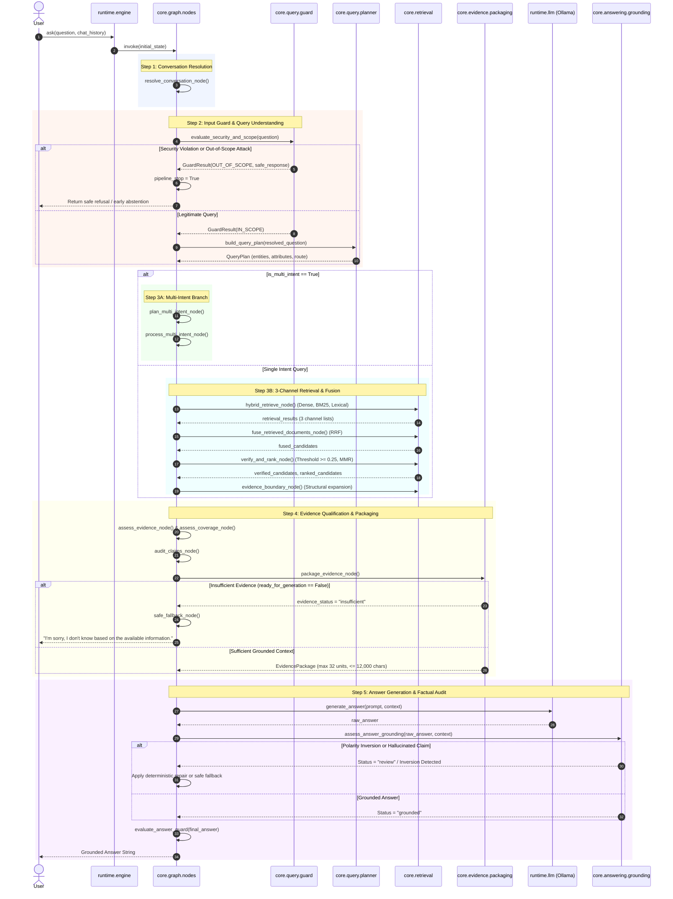

# Runtime Call Flow & Execution Tracing

**Audit Date**: October 16, 2026  
**Implementation**: `ai_platform/`  
**Composition Root**: [`ai_platform/runtime/engine.py`](file:///Users/bhuvanachandra/Desktop/RAG_Chatbot/ai_platform/runtime/engine.py)  

---

## 1. Primary Entry Points

All user queries entering the system are processed via three canonical interfaces exposed by `ai_platform/runtime/engine.py`:

```python
# 1. Simple text-to-text response
answer: str = ask(question="What are the B.Tech attendance requirements?", chat_history=())

# 2. Comprehensive diagnostic state inspection
state: dict[str, Any] = ask_with_diagnostics(question="...", chat_history=())

# 3. Direct LangGraph compiled graph invocation (used by Streamlit app.py)
graph = get_app_graph()
result: dict[str, Any] = graph.invoke({"question": question, "chat_history": chat_history})
```

---

## 2. The `RAGState` Data Contract

The pipeline is implemented as a state machine using LangGraph. The single state dictionary flowing through all nodes is defined in [`ai_platform/core/graph/state.py`](file:///Users/bhuvanachandra/Desktop/RAG_Chatbot/ai_platform/core/graph/state.py):

| State Field | Type | Description |
| :--- | :--- | :--- |
| `question` | `str` | Raw user question as submitted. |
| `chat_history` | `Sequence[tuple[str, str]]` | Prior conversational turns. |
| `resolved_question` | `str` | Query after conversational anaphora and pronoun resolution. |
| `query_plan` | `QueryPlan` | Structured query plan (intent units, entities, constraints). |
| `pipeline_stop` | `bool` | Hard fail-closed stop flag set by guard or fatal error. |
| `is_multi_intent` | `bool` | True if question splits into independent sub-queries. |
| `intent_units` | `Sequence[IntentUnit]` | Decomposed sub-intent task units. |
| `retrieval_results` | `tuple[list, list, list]` | Raw candidate lists: Dense, BM25, and Lexical. |
| `fused_candidates` | `Sequence[Candidate]` | Fused candidates after Reciprocal Rank Fusion (RRF). |
| `verified_candidates` | `Sequence[Candidate]` | Candidates passing program, entity, and relevance thresholds. |
| `ranked_candidates` | `Sequence[Candidate]` | Final relevance-scored and MMR-deduplicated candidates. |
| `evidence_package` | `EvidencePackage` | Final structured context ready for generator consumption. |
| `ready_for_generation` | `bool` | Gating boolean. If `False`, generator node is bypassed. |
| `answer` | `str` | Final user-facing grounded answer string. |
| `answer_grounding` | `GroundingResult` | Deterministic verification of factual statements. |
| `answer_guard` | `AnswerGuardResult` | Check for internal path leakage or security violations. |

---

## 3. Step-by-Step Node Execution Flow



---

## 4. Branching Logic & Decision Gates

### Gate 1: Input Scope and Security Gate (`understand_query_node`)
- **Code**: `ai_platform/core/graph/nodes.py:320-370` invoking `ai_platform/core/query/guard.py:evaluate_security_and_scope`
- **Decisions**:
  - `OUT_OF_SCOPE`: Sets `pipeline_stop = True`, zeroes all retrieval queries, and stores a predetermined safe response (e.g. lock-picking refusal, PII protection).
  - `MIXED_SCOPE_WITH_INJECTION`: Strips prompt injection commands while preserving the underlying university query.
  - `IN_SCOPE`: Proceeds to query planning.

### Gate 2: Routing After Query Planning (`_route_after_query_planning`)
- **Code**: `ai_platform/core/graph/nodes.py:440`
- **Branches**:
  - `pipeline_stop == True` $\rightarrow$ Routes immediately to `safe_fallback_node`.
  - `is_multi_intent == True` $\rightarrow$ Routes to `plan_multi_intent_node`.
  - Default $\rightarrow$ Routes to `hybrid_retrieve_node`.

### Gate 3: Candidate Verification Gate (`verify_and_rank_node`)
- **Code**: `ai_platform/core/retrieval/verification.py:verify_candidate`
- **Condition**: Candidate relevance must satisfy $S_{bounded} \ge 0.25$ (harmonized threshold). Candidates matching contradictory degree programs (e.g. Ph.D. rule for B.Tech query) are rejected.
- **Fail-Safe**: If all candidates fail verification, `verified_candidates` is empty.

### Gate 4: Generation Readiness Gate (`package_evidence_node`)
- **Code**: `ai_platform/core/graph/nodes.py:1260-1320`
- **Condition**: Sets `ready_for_generation = True` ONLY if `len(evidence_package.items) > 0` and required attribute criteria are satisfied.
- **Fail-Safe**: If `ready_for_generation == False`, the pipeline transitions to `safe_fallback_node` and returns:
  > *"I'm sorry, I don't know based on the available information."*
  This completely prevents LLM hallucinations on unsupported topics (e.g. golf courses).

### Gate 5: Factual Grounding & Polarity Inversion Gate (`answer_node`)
- **Code**: `ai_platform/core/answering/grounding.py:assess_answer_grounding`
- **Condition**: Verifies numerical figures, dates, and checks for OR-qualifier negation (e.g. evidence says "60% OR first class", model wrongly asserts "first class is not accepted").
- **Correction**: Flags inversions and substitutes verified factual statements.
