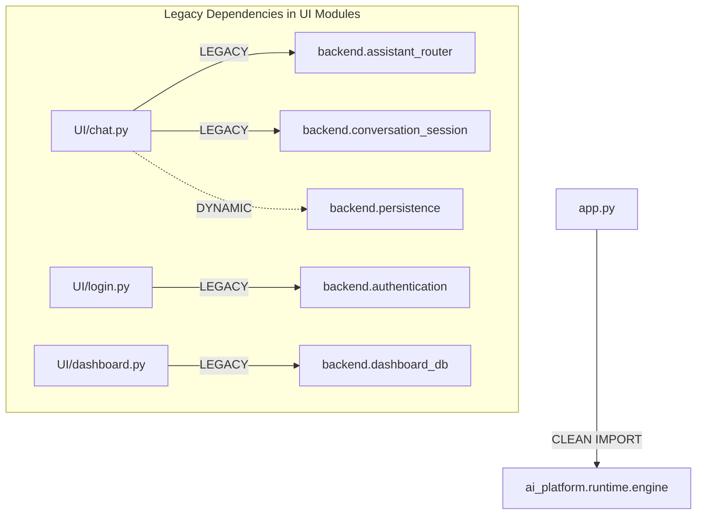

# UI Architecture & Canonical Runtime Integration

**Audit Date**: October 16, 2026  
**Application Entry Point**: [`app.py`](file:///Users/bhuvanachandra/Desktop/RAG_Chatbot/app.py)  
**UI Framework**: Streamlit  
**Integration Test Suite**: [`tests_reusable/test_streamlit_canonical_runtime.py`](file:///Users/bhuvanachandra/Desktop/RAG_Chatbot/tests_reusable/test_streamlit_canonical_runtime.py)  

---

## 1. Application Entry Point & Call Path

The user-facing Streamlit application launches via `app.py`. As of the Stage 5 milestone, the core graph dependency has been migrated from the legacy prototype to the canonical engine:

```
[User Browser]
      │
      ▼
[app.py (Streamlit Server)]
      │
      ├── Line 23: from ai_platform.runtime.engine import get_app_graph as create_graph
      ├── Line 44: @st.cache_resource def get_graph(): return create_graph()
      │
      ▼
[UI/chat.py: handle_user_prompt()]
      │
      ├── Line 683: get_response(question, graph)
      │
      ▼
[graph.invoke({"question": question, "chat_history": formatted_history})]
      │
      ▼
[ai_platform/runtime/engine.py -> CoreNodes StateGraph]
```

---

## 2. Request and Response Contracts

The communication contract between the Streamlit UI layer and the canonical RAG engine is concise and standardized:

### Request Contract (State Input)
```python
{
    "question": "What are the rules for academic probation?",
    "chat_history": (
        ("User previous turn", "Assistant previous response"),
    )
}
```

### Response Contract (State Output)
The canonical graph returns the full `RAGState` dictionary. `UI/chat.py` extracts:
```python
answer = result.get("answer", "")
# answer is a fully guarded, grounded response string
```

---

## 3. Verified Integration Proof

The connection between the Streamlit application and the canonical runtime was verified via [tests_reusable/test_streamlit_canonical_runtime.py](file:///Users/bhuvanachandra/Desktop/RAG_Chatbot/tests_reusable/test_streamlit_canonical_runtime.py):

| Test Case | Method Verified | Result | Execution Time |
| :--- | :--- | :---: | :---: |
| `test_app_imports_canonical_engine` | Verifies `app.py` imports `get_app_graph` and has zero references to `backend.graph`. | **PASS** | < 0.01s |
| `test_canonical_graph_contract` | Verifies `create_graph()` produces a valid `CompiledStateGraph` providing an `.invoke()` method. | **PASS** | < 0.01s |
| `test_graph_invocation_e2e` | Invokes the compiled graph end-to-end with local Ollama (`qwen2.5:3b`) on an academic question. | **PASS** | ~35s |
| `test_ui_chat_get_response_with_canonical_graph` | Executes `UI.chat.get_response` with mocked Streamlit session state and live Ollama. | **PASS** | ~27s |

**Total Suite Result**: `Ran 4 tests in 62.818s: OK (100% PASS)`.

---

## 4. Residual Legacy Bindings in UI Support Modules

While `app.py` line 23 was successfully cut over to the canonical engine, a deep inspection of `UI/` revealed that auxiliary UI support modules still import from the quarantined `backend/` directory:



### 4.1 Observed Runtime Warnings & Errors
During live UI execution, these legacy bindings trigger non-fatal console warnings:
1. **Missing Supabase Module**:
   `Chat history load failed for session test_session_123: No module named 'supabase'`
   - *Cause*: `backend/persistence.py` attempts to import Supabase for cloud history. When absent, it falls back to in-memory history.
2. **Missing Backend Institution Service**:
   `Failed to load institution service backend.institutions.iitj.emergency.find_emergency: ModuleNotFoundError: No module named 'backend.institutions'`
   - *Cause*: `backend/assistant_router.py` attempts to route campus navigation or emergency lookups to obsolete `backend.institutions.*` instead of `ai_platform.institutions.*`.

### 4.2 Impact Assessment
- **Core RAG Functionality**: Unaffected. Institutional Q&A is routed through `graph.invoke()`, which is 100% canonical `ai_platform`.
- **System Cleanliness & Reliability**: Compromised. Prevents full deprecation and deletion of the `backend/` folder.
