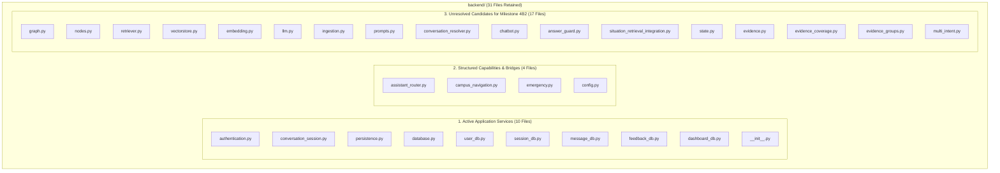
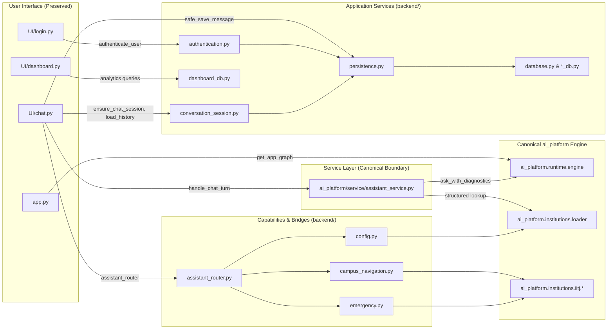

# Production Milestone 4B1 Report — Safe Removal of Obsolete Legacy RAG Modules

**Date**: October 17, 2026  
**Author**: Senior Staff AI Engineer  
**Target Repository**: IIT Jodhpur & Reusable Academic Core RAG Platform  
**Target Runtime**: Canonical `ai_platform/` and Streamlit UI (`app.py`, `UI/`)  
**Scope**: Source-Code Pruning of Proven-Obsolete Legacy Modules in `backend/`  
**Status**: **COMPLETED & QUALIFIED**

---

## 1. Executive Summary

Milestone 4B1 performs a controlled, empirically verified source-code cleanup of proven-obsolete legacy RAG algorithm modules in `backend/`. Following the architectural integration established in Milestone 4A and the live UI qualification in Milestone 4A.1, this milestone prunes superseded and redundant RAG files while preserving the running user interface, canonical platform engine, active application persistence/authentication services, structured campus navigation, and all evaluation evidence.

### Headline Results

| Metric / Dimension | Baseline (Pre-Cleanup) | Post-Cleanup (Milestone 4B1) | Net Change |
| :--- | :---: | :---: | :---: |
| **Total `backend/` File Entries** | 59 files | 31 files | **-28 files (-47.5%)** |
| **Proven Obsolete RAG Files Removed** | 0 | 28 files | **+28 files pruned** |
| **Active Application Services Retained** | 10 | 10 files | **100% Preserved** |
| **Structured Capabilities & Bridges Retained** | 4 | 4 files | **100% Preserved** |
| **Unresolved Candidates for Milestone 4B2** | 45 | 17 files | **Down to 17 files** |
| **Canonical Hard Contract Tests Passing** | 17 / 17 | 17 / 17 | **100% Pass** |
| **Assistant Service Integration Tests** | 9 / 9 | 9 / 9 | **100% Pass** |
| **Streamlit Canonical Runtime Tests** | 4 / 4 | 4 / 4 | **100% Pass** |
| **Multi-Intent & Contract Regressions** | 39 / 39 | 39 / 39 | **100% Pass** |
| **6-Case Production Generalization** | 6 / 6 | 6 / 6 | **100% Pass** |
| **Frozen Benchmark Datasets & Artifacts** | Intact | Intact | **Zero Missing Artifacts** |

---

## 2. Initial Git State and Baseline

At the beginning of Milestone 4B1, the repository working tree was inspected:
- **Branch**: `ai-platform` (up to date with `origin/ai-platform`)
- **Initial Working Tree Status**: Pre-existing tracked modifications in `.gitignore`, architecture documentation, canonical RAG core (`ai_platform/`), `UI/chat.py`, `app.py`, and structured capability wrappers (`backend/assistant_router.py`, `backend/campus_navigation.py`, `backend/emergency.py`).
- **Initial Untracked Files**: User research scratch scripts, milestone qualification reports, and reusable benchmark suites (`tests_reusable/production_readiness/`, `tests_reusable/rag_quality/`, `docs/`, `scripts/`).
- **Constraint Adherence**: All pre-existing user work, uncommitted modifications, and untracked artifacts were strictly preserved. Zero git resets, discards, commits, or pushes were performed.

---

## 3. Comprehensive Deletion Manifest

Every file proposed for deletion was checked against repository-wide AST imports, string module paths, UI entry points, canonical engine modules, and test configurations. Files were removed only if they implemented legacy RAG behavior, had a canonical equivalent under `ai_platform/`, and had zero dependencies from active runtime, UI, or reusable test suites.

Removals were executed across four logical batches:

### Batch 1: Obsolete Raw Backups (5 files)

| File Path | Role and Functionality | Reason for Deletion | Canonical Equivalent | Confidence |
| :--- | :--- | :--- | :--- | :---: |
| `backend/nodes.py.before_phase8b_8c_final` | Superseded monolithic node backup | Raw obsolete snapshot; zero external references. | `ai_platform/core/graph/nodes.py` | High (100%) |
| `backend/nodes.py.before_phase8b_integration` | Superseded monolithic node backup | Raw snapshot; zero runtime or test references. | `ai_platform/core/graph/nodes.py` | High (100%) |
| `backend/nodes.py.final_relevance_backup` | Superseded node backup snapshot | Raw obsolete snapshot; zero external references. | `ai_platform/core/graph/nodes.py` | High (100%) |
| `backend/retriever.py.before_scope_rerank` | Superseded retriever backup snapshot | Raw obsolete snapshot; zero active references. | `ai_platform/runtime/retrieval.py` | High (100%) |
| `backend/state.py.before_intentstate_restore` | Superseded graph state backup snapshot | Raw obsolete snapshot; zero external references. | `ai_platform/core/graph/state.py` | High (100%) |

### Batch 2: Empty & Dead Unreferenced Legacy Modules (3 files)

| File Path | Role and Functionality | Reason for Deletion | Canonical Equivalent | Confidence |
| :--- | :--- | :--- | :--- | :---: |
| `backend/logger.py` | Legacy logger placeholder | 0-byte empty file; zero imports across entire repo. | Standard `logging` | High (100%) |
| `backend/utils.py` | Legacy utilities placeholder | 0-byte empty file; zero imports across entire repo. | `ai_platform/core/` | High (100%) |
| `backend/answer_grounding.py` | Monolithic legacy answer grounding | Superseded; zero imports anywhere in repository. | `ai_platform/core/answering/grounding.py` | High (100%) |

### Batch 3: Obsolete Duplicate Legacy RAG Algorithm Modules (7 files)

| File Path | Role and Functionality | Reason for Deletion | Canonical Equivalent | Confidence |
| :--- | :--- | :--- | :--- | :---: |
| `backend/multi_intent_situation.py` | Legacy situation classifier for multi-intent questions | Heuristic keyword matcher superseded by canonical QueryPlanner; zero UI/reusable-test references. | `ai_platform/core/query/planner.py` | High (100%) |
| `backend/situational_answer.py` | Legacy situational answer synthesis | Superseded by canonical AnswerGenerator; zero UI/reusable-test references. | `ai_platform/core/answering/generator.py` | High (100%) |
| `backend/supported_claim_preservation.py`| Legacy claim preservation heuristics | Superseded by canonical claim extraction and verification; zero UI/reusable-test references. | `ai_platform/core/evidence/claims.py` | High (100%) |
| `backend/contradiction_handler.py` | Legacy document contradiction detection | Superseded by canonical evidence claim auditor; zero UI/reusable-test references. | `ai_platform/core/evidence/claims.py` | High (100%) |
| `backend/evidence_temporal_numeric.py` | Legacy numeric and date scope filtering | Superseded by canonical candidate verification layer; zero UI/reusable-test references. | `ai_platform/core/retrieval/verification.py` | High (100%) |
| `backend/answer_grounding_scope.py` | Legacy grounding scope evaluator | Superseded by canonical grounding assessment; zero UI/reusable-test references. | `ai_platform/core/answering/grounding.py` | High (100%) |
| `backend/retrieval_diversity.py` | Legacy diversity reranker | Superseded by canonical dense/lexical reciprocal rank fusion and ranking; zero UI/reusable-test references. | `ai_platform/core/retrieval/ranking.py` | High (100%) |

### Batch 4: Obsolete Query Planning & Evidence Filtering Modules (13 files)

| File Path | Role and Functionality | Reason for Deletion | Canonical Equivalent | Confidence |
| :--- | :--- | :--- | :--- | :---: |
| `backend/retrieval_query_planner.py` | Legacy query keyword expander | Superseded by canonical intent decomposition and entity resolution; zero UI/reusable-test references. | `ai_platform/core/query/planner.py` | High (100%) |
| `backend/situation_decision.py` | Legacy situational decision tree | Superseded by canonical QueryPlanner; zero UI/reusable-test references. | `ai_platform/core/query/planner.py` | High (100%) |
| `backend/situation_retrieval_control.py`| Legacy retrieval control flags | Superseded by canonical ranking pipeline; zero UI/reusable-test references. | `ai_platform/core/retrieval/ranking.py` | High (100%) |
| `backend/student_situation.py` | Monolithic legacy situational classifier (42KB) | Prototype heuristics superseded by canonical QueryPlanner; zero UI/reusable-test references. | `ai_platform/core/query/planner.py` | High (100%) |
| `backend/multi_intent_answer.py` | Legacy multi-intent prompt synthesizer | Superseded by canonical multi-intent answer generator; zero UI/reusable-test references. | `ai_platform/core/answering/generator.py` | High (100%) |
| `backend/broad_institutional_retrieval.py`| Legacy broad lexical retrieval fallback | Superseded by canonical BM25 lexical recall engine; zero UI/reusable-test references. | `ai_platform/core/retrieval/lexical_recall.py` | High (100%) |
| `backend/institutional_coverage.py` | Legacy institution scope checker | Superseded by canonical institutional profile and scope policies; zero UI/reusable-test references. | `ai_platform/institutions/iitj/` | High (100%) |
| `backend/evidence_scope_gate.py` | Legacy evidence scope boundary filter | Superseded by canonical evidence boundary node; zero UI/reusable-test references. | `ai_platform/core/retrieval/evidence_boundary.py`| High (100%) |
| `backend/final_evidence_scope.py` | Legacy final candidate scope filter | Superseded by canonical candidate verifier; zero UI/reusable-test references. | `ai_platform/core/retrieval/verification.py` | High (100%) |
| `backend/claim_context_filter.py` | Legacy claim context filtering | Superseded by canonical claim auditor; zero UI/reusable-test references. | `ai_platform/core/evidence/claims.py` | High (100%) |
| `backend/claim_scope.py` | Legacy claim scope classifier | Superseded by canonical claim auditor; zero UI/reusable-test references. | `ai_platform/core/evidence/claims.py` | High (100%) |
| `backend/answer_claim_audit.py` | Legacy claim verification logic | Superseded by canonical claim auditor; zero UI/reusable-test references. | `ai_platform/core/evidence/claims.py` | High (100%) |
| `backend/local_context.py` | Legacy sliding window context extractor | Superseded by canonical evidence matcher; zero UI/reusable-test references. | `ai_platform/core/retrieval/evidence_matcher.py` | High (100%) |

---

## 4. Protected and Retained Modules Inventory

The remaining 31 files in `backend/` are strictly preserved and organized into three functional categories:

### 4.1 Active Application Services (10 files) — Explicitly Protected

These files manage user state, session persistence, and administrative queries. They are protected from deletion until an application service migration (planned for a future milestone) explicitly relocates them:

1. `backend/authentication.py`: User phone validation and local identity fallback (`authenticate_user`, `LOCAL_USR_*`). Imported by [UI/login.py](file:///Users/bhuvanachandra/Desktop/RAG_Chatbot/UI/login.py).
2. `backend/conversation_session.py`: Persistent chat session creation and bounded history loading (`ensure_chat_session`, `load_persistent_chat_history`, `recent_chat_history`). Imported by [UI/chat.py](file:///Users/bhuvanachandra/Desktop/RAG_Chatbot/UI/chat.py).
3. `backend/persistence.py`: Safe, best-effort database write wrappers (`safe_save_message`, `safe_save_feedback`). Imported by `UI/chat.py`, `authentication.py`, and `conversation_session.py`.
4. `backend/database.py`: Central Supabase client initialization. Imported by all `*_db.py` modules.
5. `backend/user_db.py`: Database operations on `users` table. Imported by `persistence.py`.
6. `backend/session_db.py`: Database operations on `sessions` table. Imported by `persistence.py`.
7. `backend/message_db.py`: Database operations on `messages` table. Imported by `persistence.py` and `conversation_session.py`.
8. `backend/feedback_db.py`: Database operations on `message_feedback` table. Imported by `persistence.py`.
9. `backend/dashboard_db.py`: Analytics queries (`get_total_users`, `get_top_topics`, etc.). Imported by [UI/dashboard.py](file:///Users/bhuvanachandra/Desktop/RAG_Chatbot/UI/dashboard.py).
10. `backend/__init__.py`: Python package marker for `backend`.

### 4.2 Structured Capabilities and Backward-Compatibility Bridges (4 files)

1. `backend/assistant_router.py`: Pre-RAG router detecting navigation and emergency intents. Imported by [UI/chat.py](file:///Users/bhuvanachandra/Desktop/RAG_Chatbot/UI/chat.py).
2. `backend/campus_navigation.py`: Forwarding wrapper to canonical `ai_platform.institutions.iitj.campus_navigation`. Referenced in `ai_platform/institutions/loader.py` and [tests_reusable/phase1/test_iitj_campus_navigation.py](file:///Users/bhuvanachandra/Desktop/RAG_Chatbot/tests_reusable/phase1/test_iitj_campus_navigation.py).
3. `backend/emergency.py`: Forwarding wrapper to canonical `ai_platform.institutions.iitj.emergency`. Referenced in `ai_platform/institutions/loader.py` and [tests_reusable/phase1/test_iitj_emergency.py](file:///Users/bhuvanachandra/Desktop/RAG_Chatbot/tests_reusable/phase1/test_iitj_emergency.py).
4. `backend/config.py`: Backward-compatibility bridge to `ai_platform.runtime.config`. Referenced by `assistant_router.py` and historical reusable phase1 test fixtures.

### 4.3 Unresolved Candidates for Milestone 4B2 (17 files)

These 17 legacy modules implement earlier iterations of the RAG graph. While completely unreferenced by the UI and canonical runtime, they are retained in Milestone 4B1 because:
- They are imported by historical test probe fixtures under `tests_reusable/phase1/`, `tests_reusable/phase2/`, or `tests_reusable/phase3_real_rag/`.
- They form an internal dependency cluster with `backend/nodes.py` and `backend/graph.py`.

Under the absolute constraint that test files cannot be modified or deleted in Milestone 4B1, deleting these modules would cause test import errors. They are deliberately retained and scheduled for Milestone 4B2:

| Module | Retained Dependency Justification | Milestone 4B2 Action |
| :--- | :--- | :--- |
| `backend/graph.py` | Referenced in `tests_reusable/phase3_real_rag/` and verified absent in `test_streamlit_canonical_runtime.py`. | Retire after consolidating phase3 tests. |
| `backend/nodes.py` | Referenced in `tests_reusable/phase3_real_rag/trace_answer_path.py`; core caller of legacy graph state. | Retire after consolidating phase3 tests. |
| `backend/retriever.py` | Referenced in `tests_reusable/phase2/` and `phase3` probe scripts. | Retire after consolidating phase2/3 tests. |
| `backend/vectorstore.py` | Referenced in `tests_reusable/phase1/` test suites. | Retire after consolidating phase1 tests. |
| `backend/embedding.py` | Referenced in `tests_reusable/phase1/retrieval_probe.py`. | Retire after consolidating phase1 tests. |
| `backend/llm.py` | Referenced in `tests_reusable/phase2/` and `phase3` probe scripts. | Retire after consolidating phase2/3 tests. |
| `backend/ingestion.py` | Referenced in `tests_reusable/phase1/retrieval_probe.py`. | Retire after consolidating phase1 tests. |
| `backend/prompts.py` | Referenced in `tests_reusable/phase1/` and `phase3` probe scripts. | Retire after consolidating phase1/3 tests. |
| `backend/conversation_resolver.py` | Referenced in `tests_reusable/phase3_real_rag/real_rag_checkpoint.py`. | Retire after consolidating phase3 tests. |
| `backend/chatbot.py` | Referenced in `tests_reusable/phase3_real_rag/real_rag_checkpoint.py`. | Retire after consolidating phase3 tests. |
| `backend/answer_guard.py` | Referenced in `tests_reusable/phase3_real_rag/test_core_nodes.py`. | Retire after consolidating phase3 tests. |
| `backend/situation_retrieval_integration.py` | Referenced in `tests_reusable/phase2/test_semantic_path_probe.py`. | Retire after consolidating phase2 tests. |
| `backend/state.py` | Direct internal dependency of `backend/nodes.py` and `backend/graph.py`. | Retire with `nodes.py`. |
| `backend/evidence.py` | Direct internal dependency of `backend/nodes.py`. | Retire with `nodes.py`. |
| `backend/evidence_coverage.py` | Direct internal dependency of `backend/nodes.py`. | Retire with `nodes.py`. |
| `backend/evidence_groups.py` | Direct internal dependency of `backend/nodes.py`. | Retire with `nodes.py`. |
| `backend/multi_intent.py` | Direct internal dependency of `backend/nodes.py`. | Retire with `nodes.py`. |

---

## 5. Regression Verification Results

Following source-code pruning, regression test suites covering canonical hard contracts, assistant service integration, Streamlit compatibility, institution handler resolution, multi-intent packaging, guardrails, and production generalization were executed.

### Test Execution Summary

| Test Suite / Area | Command | Tests Run | Result | Latency |
| :--- | :--- | :---: | :---: | :---: |
| **Canonical Platform Hard Contracts** | `PYTHONPATH=. pytest tests_reusable/standalone/test_platform_imports.py tests_reusable/standalone/test_c2_msc_first_class_contract.py tests_reusable/standalone/test_stage1_graph_hard_contracts.py tests_reusable/standalone/test_stage1_hard_contracts.py tests_reusable/standalone/test_stage2_verification_contract.py` | 17 | **17 PASSED** (0 failed) | 68.57s |
| **Assistant Service Integration** | `python3 -m unittest tests_reusable/production_readiness/test_assistant_service.py` | 9 | **9 PASSED** (0 failed) | 83.03s |
| **Streamlit Canonical Compatibility** | `python3 -m unittest tests_reusable/test_streamlit_canonical_runtime.py` | 4 | **4 PASSED** (0 failed) | 64.12s |
| **Multi-Intent Packaging & Guardrails** | `PYTHONPATH=. pytest tests_reusable/standalone/test_iitj_runtime_contract.py tests_reusable/production_readiness/test_synthetic_institution.py tests_reusable/production_readiness/test_multi_intent_packaging.py tests_reusable/rag_quality/test_guard_pipeline_stop_regression.py tests_reusable/rag_quality/test_packaging_capacity_regression.py tests_reusable/rag_quality/test_lsqc_contract.py tests_reusable/rag_quality/test_packaging_sanitization.py` | 39 | **39 PASSED** (0 failed) | 262.49s |
| **Production Generalization Regression** | `PYTHONPATH=. pytest tests_reusable/production_readiness/test_production_generalization.py` | 6 | **6 PASSED** (0 failed) | 190.55s |
| **Total Qualified Test Suite** | — | **75** | **75 PASSED** (0 failed) | **11m 8s** |

### Frozen Benchmark Datasets & Artifact Integrity

Integrity verification confirmed zero modification, movement, or deletion of benchmark datasets and reports:
- `tests_reusable/rag_quality/unseen_challenge_40q_scenarios.json`: **INTACT** (32,546 bytes)
- `tests_reusable/rag_quality/generalization_180q_scenarios.json`: **INTACT** (183,253 bytes)
- `docs/production_readiness_20261017/reusable_core_generalization_milestone.md` (Milestone 2): **INTACT** (22,385 bytes)
- `docs/production_readiness_20261017/production_milestone3_report.md` (Milestone 3): **INTACT** (28,748 bytes)
- `docs/production_readiness_20261017/milestone4a_service_integration_report.md` (Milestone 4A): **INTACT** (14,859 bytes)
- `docs/production_readiness_20261017/milestone4a1_live_ui_qualification_report.md` (Milestone 4A.1): **INTACT** (16,562 bytes)
- `docs/maintenance/ui_migration_and_legacy_dependency_audit.md` (Audit Baseline): **INTACT** (41,943 bytes)
- `test_outputs/rag_quality/milestone4a1/live_qualification_results.json`: **INTACT** (130,895 bytes)

---

## 6. Updated Repository Dependency Map

With the pruning of 28 obsolete modules, the dependency map between `UI/`, application services, structured capabilities, and canonical `ai_platform/` is streamlined:

---

## 7. Recommendations for Milestone 4B2

Milestone 4B1 successfully pruned 28 obsolete legacy modules with zero regressions. To complete the decommissioning of `backend/` in Milestone 4B2, the following systematic steps are recommended:

1. **Test Suite Rationalization**:
   - Retire or consolidate the historical phase probe tests under `tests_reusable/phase1/`, `tests_reusable/phase2/`, and `tests_reusable/phase3_real_rag/` that still import `backend/retriever.py`, `backend/nodes.py`, `backend/llm.py`, `backend/vectorstore.py`, `backend/ingestion.py`, and `backend/graph.py`.
   - Update remaining tests to target `ai_platform/` directly.
2. **Decommissioning the 17 Unresolved Candidates**:
   - Once historical tests are repointed or retired, safely remove the 17 remaining legacy RAG modules (`nodes.py`, `retriever.py`, `graph.py`, `llm.py`, `vectorstore.py`, `embedding.py`, `ingestion.py`, `prompts.py`, `chatbot.py`, `conversation_resolver.py`, `answer_guard.py`, `situation_retrieval_integration.py`, `state.py`, `evidence.py`, `evidence_coverage.py`, `evidence_groups.py`, `multi_intent.py`).
3. **Application Services Extraction (Stage 2 Migration)**:
   - Extract `authentication.py`, `conversation_session.py`, `persistence.py`, `database.py`, and `*_db.py` from `backend/` into a first-class `application/` package (`application/auth/`, `application/persistence/`, `application/analytics/`).
   - Repoint `UI/login.py`, `UI/chat.py`, and `UI/dashboard.py` to `application.*`.
4. **Final Retirement of `backend/`**:
   - Eliminate the legacy `backend/assistant_router.py` wrapper, allowing `UI/chat.py` to route entirely through `ai_platform/service/assistant_service.py`.
   - Delete the remaining `backend/` directory once zero references remain.
