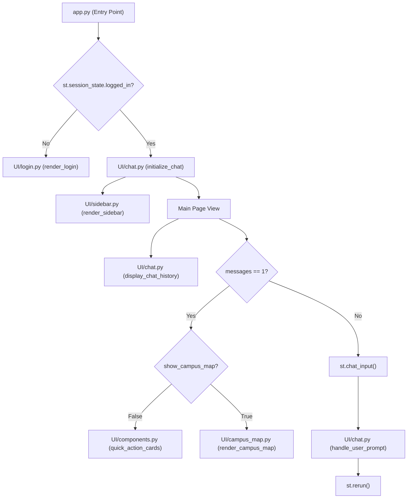
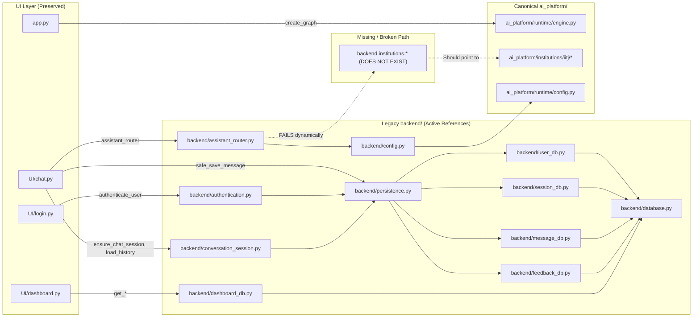
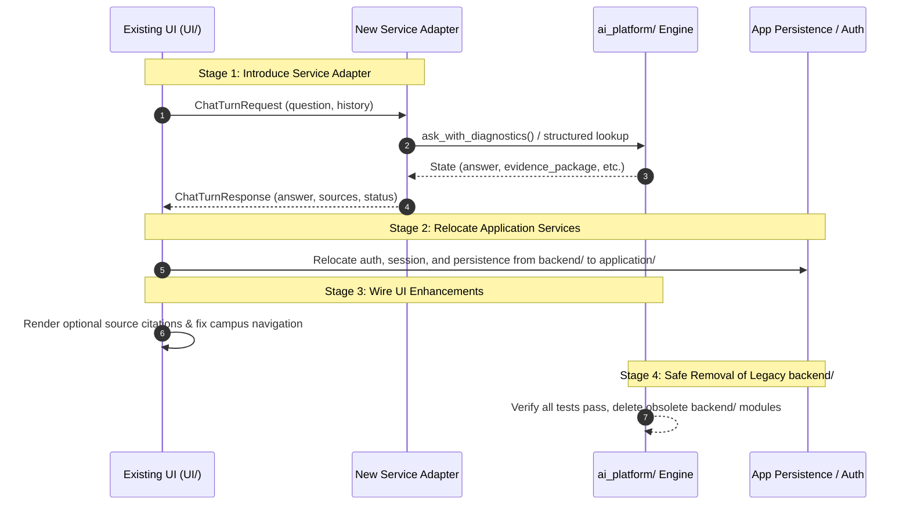

# UI Preservation and Legacy Backend Dependency Audit & Migration Plan

**Date**: October 17, 2026  
**Author**: Senior Staff AI/ML Engineer  
**Target Repository**: IIT Jodhpur & Reusable Academic Core RAG Platform  
**Scope**: UI Architecture, Legacy Backend (`backend/`) Dependency Graph, Canonical Engine (`ai_platform/`) Integration, and Test Suite Inventory  
**Status**: Read-Only Audit & Actionable Plan (No Destructive Actions Taken)

---

## Executive Summary

The canonical RAG architecture for this platform has been successfully modularized and qualified under `ai_platform/` (achieving **37/40 (92.5%)** on the frozen unseen challenge benchmark and **100% negative control safe refusal**). However, the application's user interface (`UI/` and `app.py`) historically interacted with an earlier monolithic backend (`backend/`), which itself contains 59 Python files, legacy database shims, and multiple generations of superseded RAG components.

This audit establishes:
1. **The UI is already halfway migrated**: The primary entry point [app.py](file:///Users/bhuvanachandra/Desktop/RAG_Chatbot/app.py) already imports and instantiates the canonical graph via `from ai_platform.runtime.engine import get_app_graph as create_graph`.
2. **The UI's active legacy backend dependencies are NOT RAG algorithms**: The UI depends on `backend/` strictly for:
   - **Authentication and session creation** ([backend/authentication.py](file:///Users/bhuvanachandra/Desktop/RAG_Chatbot/backend/authentication.py)).
   - **Message and session database persistence** ([backend/conversation_session.py](file:///Users/bhuvanachandra/Desktop/RAG_Chatbot/backend/conversation_session.py), [backend/persistence.py](file:///Users/bhuvanachandra/Desktop/RAG_Chatbot/backend/persistence.py)).
   - **Pre-RAG structured routing for campus navigation & emergency services** ([backend/assistant_router.py](file:///Users/bhuvanachandra/Desktop/RAG_Chatbot/backend/assistant_router.py)).
   - **Administrative dashboard analytics queries** ([backend/dashboard_db.py](file:///Users/bhuvanachandra/Desktop/RAG_Chatbot/backend/dashboard_db.py)).
3. **A critical latent bug exists in `backend/assistant_router.py`**: It attempts to dynamically load `backend.institutions.{institution_id}.campus_navigation`, but `backend.institutions` does not exist in the repository (it was reorganized into `ai_platform/institutions/iitj/`). Consequently, campus navigation and emergency structured routing silently fail and fall through to RAG.
4. **All 40+ legacy RAG algorithmic files in `backend/` are completely orphaned from the UI**: Files like `backend/nodes.py`, `backend/retriever.py`, `backend/evidence.py`, `backend/student_situation.py`, etc., have **zero references from `UI/` or `app.py`**. They are kept alive exclusively by historical tests in `tests/`.
5. **Zero destructive actions are taken in this phase**: Preserves all UI code, tests, datasets, benchmark outputs, and legacy modules until an explicit migration adapter is introduced.

---

## Section 1: Existing UI Feature and Workflow Inventory

### 1.1 Screens and Page Structure

The user interface is built on Streamlit with an expanded sidebar layout:



1. **Login Gatekeeper Screen** ([UI/login.py](file:///Users/bhuvanachandra/Desktop/RAG_Chatbot/UI/login.py)):
   - **Role**: Blocks unauthenticated access to the assistant.
   - **Inputs**: Full Name (`st.text_input`), 10-digit Phone Number (`st.text_input`, `max_chars=10`).
   - **Validation**: Name length $\ge 3$ characters; Phone must be exactly 10 digits (`isdigit()`).
   - **Behavior**: Calls `authenticate_user(name, phone)`. On success, sets `st.session_state.logged_in = True`, records `user_id`, `user_name`, `session_id`, `persistence_available`, `persistence_mode`, and triggers `st.rerun()`. On failure, displays `st.error`.

2. **Sidebar Navigation** ([UI/sidebar.py](file:///Users/bhuvanachandra/Desktop/RAG_Chatbot/UI/sidebar.py)):
   - **Title**: `🎓 IITJ Assistant`.
   - **New Chat Action**: `➕ New Chat` button calls `create_new_chat()` from [UI/chat.py](file:///Users/bhuvanachandra/Desktop/RAG_Chatbot/UI/chat.py).
   - **Chat History Switcher**: Renders a list of all conversations in `st.session_state.conversations`. Shows `🟢` for active chat and `⚪` for inactive chats. Clicking switches `st.session_state.active_chat` and reruns.
   - **About Section**: Bulleted overview of supported topics (Admissions, Academics, Departments, Research, Hostel, Campus Life, Facilities).
   - **Footer**: Attributions ("Built with ❤️ using LangGraph, ChromaDB, Streamlit").

3. **Active Chat Screen** ([UI/chat.py](file:///Users/bhuvanachandra/Desktop/RAG_Chatbot/UI/chat.py)):
   - **History Display**: `display_chat_history()` renders user and assistant turns using `st.chat_message`. Assistant turns display a latency caption (`⏱️ Response Time: X.XX seconds`).
   - **Input Box**: `st.chat_input("Ask anything about IIT Jodhpur...")`.
   - **Turn Execution**: `handle_user_prompt(prompt, graph)` manages saving turns locally, persisting to database, calling the backend graph, and rendering spinner (`Thinking...`).

4. **Quick Action Cards** ([UI/components.py](file:///Users/bhuvanachandra/Desktop/RAG_Chatbot/UI/components.py)):
   - Shown only when a conversation has exactly 1 message (the initial greeting).
   - Pre-canned prompts for:
     - `🗺️ Campus Map`: Toggles `st.session_state.show_campus_map = True`.
     - `🎓 Admissions`: Comprehensive admission/reporting guidance query.
     - `🚨 Emergency`: Medical centre, ambulance, security contact query.
     - `🏠 Hostel & Mess`: Facilities, mess, laundry, and hostel rules query.
     - `📚 Library & IT`: Library, Wi-Fi, ERP, and computing centre query.

5. **Campus Map View** ([UI/campus_map.py](file:///Users/bhuvanachandra/Desktop/RAG_Chatbot/UI/campus_map.py)):
   - Reads [data/campus_locations.json](file:///Users/bhuvanachandra/Desktop/RAG_Chatbot/data/campus_locations.json).
   - Renders a 2-column grid of location buttons (e.g. Administrative Block, Lecture Hall Complex, Central Library, Hostels, Medical Centre).
   - Clicking a location auto-submits: `Where is the {selected_location}?`.
   - Includes a `⬅ Back` button that resets `show_campus_map = False`.

6. **Dashboard Screen** ([UI/dashboard.py](file:///Users/bhuvanachandra/Desktop/RAG_Chatbot/UI/dashboard.py)):
   - Administrative analytics interface with metrics: Total Users, Total Sessions, Total Questions, Average Latency, Today's Users, Today's Questions, Questions per User/Session.
   - Top Asked Topics table (categorized across 15 campus domains).
   - Latest Questions expander table with timestamps.
   - *Note*: `show_dashboard()` exists in `UI/` but is not currently wired into `app.py`'s main navigation.

7. **Custom Styling** ([UI/styles.py](file:///Users/bhuvanachandra/Desktop/RAG_Chatbot/UI/styles.py)):
   - Injects custom CSS hiding the Streamlit header, enforcing a 320px sidebar width, adjusting container padding, and rounding button borders.

### 1.2 User Journeys and Application Modes

1. **Student / Visitor Admission Inquiry**:
   - User logs in with name and mobile.
   - Clicks "🎓 Admissions" quick action or types a question about eligibility or deadlines.
   - Graph resolves query, evaluates evidence, generates answer, and persists turn.
2. **Campus Navigation & Facilities**:
   - User clicks "🗺️ Campus Map", selects "Medical Centre", or types "Where is the dining hall?".
   - Pre-RAG router inspects query for navigation keywords.
   - Intended to display structured facility hours and Google Maps links alongside RAG answers.
3. **Multi-Session Context Isolation**:
   - User creates multiple concurrent chats (`➕ New Chat`) in the sidebar.
   - Each chat maintains its own independent history in Streamlit session state and receives a distinct persistent database `session_id`.
   - History passed into RAG graph is strictly scoped to the active chat.

---

## Section 2: UI-to-Legacy-Backend Dependency Map

The following map traces every import and runtime call from `UI/` into `backend/`:



### Detailed Dependency Matrix

| UI File | Symbol Referenced | Legacy Backend Module | Expected Behavior | Canonical Equivalent in `ai_platform/` | Adapter / Migration Requirement | Removal Status |
| :--- | :--- | :--- | :--- | :--- | :--- | :--- |
| [UI/login.py](file:///Users/bhuvanachandra/Desktop/RAG_Chatbot/UI/login.py#L3) | `authenticate_user` | [backend/authentication.py](file:///Users/bhuvanachandra/Desktop/RAG_Chatbot/backend/authentication.py) | Phone-number login; queries/creates user and session in Supabase; falls back to `LOCAL_USR_*` if DB is offline. | *None* (Authentication is an application-level service, not a RAG core responsibility). | Move `authentication.py` into an `application/services/` layer or standalone auth module. | Must retain until extracted to app service. |
| [UI/chat.py](file:///Users/bhuvanachandra/Desktop/RAG_Chatbot/UI/chat.py#L45) | `assistant_router` | [backend/assistant_router.py](file:///Users/bhuvanachandra/Desktop/RAG_Chatbot/backend/assistant_router.py) | Detects navigation/emergency keywords; routes to structured services; sets `need_rag: bool`. | Structured navigation & emergency data exist in [ai_platform/institutions/iitj/](file:///Users/bhuvanachandra/Desktop/RAG_Chatbot/ai_platform/institutions/iitj/). | Repoint router to import directly from `ai_platform.institutions.iitj` rather than non-existent `backend.institutions`. | Must retain or replace with canonical router adapter. |
| [UI/chat.py](file:///Users/bhuvanachandra/Desktop/RAG_Chatbot/UI/chat.py#L49-L53) | `ensure_chat_session`, `load_persistent_chat_history`, `recent_chat_history` | [backend/conversation_session.py](file:///Users/bhuvanachandra/Desktop/RAG_Chatbot/backend/conversation_session.py) | Scopes chat to database session; loads recent messages; enforces `max_messages=8` bounded window. | Semantic conversation resolution is in `ai_platform.core.conversation.conversation`, but persistence is an app concern. | Move session management to `application/services/session_store.py`. | Must retain until extracted to app service. |
| [UI/chat.py](file:///Users/bhuvanachandra/Desktop/RAG_Chatbot/UI/chat.py#L878), [L979](file:///Users/bhuvanachandra/Desktop/RAG_Chatbot/UI/chat.py#L979) | `safe_save_message` | [backend/persistence.py](file:///Users/bhuvanachandra/Desktop/RAG_Chatbot/backend/persistence.py) | Best-effort asynchronous/safe write of user and assistant messages and latencies to Supabase. | *None* (Persistence is an application-level concern). | Move with persistence layer to `application/persistence/`. | Must retain until extracted to app service. |
| [UI/dashboard.py](file:///Users/bhuvanachandra/Desktop/RAG_Chatbot/UI/dashboard.py#L3-L14) | `get_total_users`, `get_total_sessions`, etc. (10 functions) | [backend/dashboard_db.py](file:///Users/bhuvanachandra/Desktop/RAG_Chatbot/backend/dashboard_db.py) | Aggregates user counts, message timestamps, response latencies, and categorizes top topics. | *None* (Analytics is an application-level database concern). | Move with database modules to `application/analytics/`. | Must retain until extracted to app service. |
| [app.py](file:///Users/bhuvanachandra/Desktop/RAG_Chatbot/app.py#L23) | `create_graph` | [ai_platform/runtime/engine.py](file:///Users/bhuvanachandra/Desktop/RAG_Chatbot/ai_platform/runtime/engine.py) | Returns compiled production LangGraph. | `ai_platform.runtime.engine.get_app_graph` | Already connected to canonical runtime! | **Fully Migrated**. |

---

## Section 3: Current Canonical Engine Integration Capabilities

The canonical runtime entry point [ai_platform/runtime/engine.py](file:///Users/bhuvanachandra/Desktop/RAG_Chatbot/ai_platform/runtime/engine.py) provides three public interfaces:

### 3.1 Public Functions in `ai_platform/runtime/engine.py`

1. **`get_app_graph() -> CompiledStateGraph`**:
   - Instantiates and caches the complete, compiled LangGraph.
   - Directly invokable with state dictionary: `graph.invoke({"question": str, "chat_history": Sequence[dict]})`.
   - Returns full state dictionary including `answer`, `evidence_package`, `query`, etc.

2. **`ask(question: str, *, chat_history: Sequence[Any] | None = None, institution_profile: Any | None = None) -> str`**:
   - Cleanest high-level string-to-string API.
   - Cleans whitespace, validates question non-emptiness.
   - Invokes canonical graph and extracts `result["answer"]`.
   - Raises `ValueError` on empty query, `RuntimeError` on missing answer.

3. **`ask_with_diagnostics(question: str, *, chat_history: Sequence[Any] | None = None, institution_profile: Any | None = None) -> dict[str, Any]`**:
   - Returns the complete final state dictionary of the graph.
   - Exposes `answer`, `sources`, `evidence_package`, `pipeline_stop`, `stop_reason`, `claims`, `claim_audit`, etc.

4. **`inspect_context(question: str, ...) -> dict[str, Any]`**:
   - Runs retrieval, verification, and packaging **without invoking LLM generation**.
   - Returns structured evidence units, prompt messages, token counts, and abstention rationale. Useful for offline evaluation, debugging, and audit tooling.

### 3.2 Supported Behavior vs Missing Contracts

| Capability | Canonical Engine (`ai_platform/`) Status | UI Currently Consumes | Gap / Translation Required |
| :--- | :--- | :--- | :--- |
| **Conversational History** | Accepts `chat_history: Sequence[dict]` with `role` and `content`. Automatically resolves coreferences (e.g., "what about its fee?"). | Passes recent history via `_select_previous_history()`. | **Fully Aligned**. No schema translation required. |
| **Grounded Answer** | Generates verified answer text or institutional fallback on evidence gaps. | Renders markdown via `st.markdown(answer)`. | **Fully Aligned**. |
| **Citations & Sources** | Exposes full evidence units with `evidence_id`, `source`, `heading`, and `text` in `evidence_package.items`. | Discards sources; only displays answer text and response time caption. | **UI Enhancement Opportunity**: Adapter can expose `sources: list[dict]` so UI can render an expandable citation drawer. |
| **Safe Fallback / Stop** | Returns `pipeline_stop: True`, `stop_reason`, and `safe_response`. | Treated as standard answer string. | **Aligned**. Can optionally add a visual badge for safe refusal. |
| **Structured Navigation** | Navigation dataset and logic exist in `ai_platform/institutions/iitj/campus_navigation.py`. | Expects `{ "type": "navigation", "data": {...} }` from `assistant_router`. | **Broken in legacy backend**; router needs to import from `ai_platform.institutions.iitj`. |
| **Structured Emergency** | Emergency contacts exist in `ai_platform/institutions/iitj/emergency.py`. | Expects `{ "type": "emergency", "data": {...} }` from `assistant_router`. | **Broken in legacy backend**; router needs to import from `ai_platform.institutions.iitj`. |
| **Streaming Responses** | Current canonical engine runs synchronously via LangGraph. | UI runs synchronously under `with st.spinner("Thinking..."):`. | **Aligned**. Streaming is a future enhancement (Milestone 4). |

---

## Section 4: Proposed Minimal UI-to-Engine Integration Boundary

### 4.1 Recommendation: In-Process Service Adapter

We recommend introducing an **in-process Service Adapter** (`ai_platform/service/assistant_service.py` or `UI/service_adapter.py`) rather than a standalone HTTP/REST API boundary at this stage:
- **Rationale**: Streamlit runs locally as a single-process Python application. Introducing a separate FastAPI/Uvicorn server would add multi-process deployment overhead, port management, inter-process serialization latency, and Docker complexity without current functional benefit.
- **Future-Proof**: The adapter's interface will be structured as pure Python dataclasses so that wrapping it in a FastAPI router for mobile/external frontends later is a 20-line addition.

### 4.2 Proposed Contract Dataclasses

```python
from dataclasses import dataclass, field
from typing import Any, Sequence

@dataclass(frozen=True)
class ChatTurnRequest:
    """Input contract sent by the UI to the assistant service."""
    question: str
    chat_history: Sequence[dict[str, str]] = field(default_factory=tuple)
    user_id: str | None = None
    session_id: str | None = None
    institution_id: str = "iitj"

@dataclass(frozen=True)
class EvidenceSourceItem:
    """Structured citation item for UI display."""
    source_document: str
    heading: str
    excerpt: str

@dataclass(frozen=True)
class ChatTurnResponse:
    """Output contract returned by the assistant service to the UI."""
    answer: str
    structured_blocks: list[dict[str, Any]] = field(default_factory=list) # Navigation / Emergency
    sources: list[EvidenceSourceItem] = field(default_factory=list)
    latency_seconds: float = 0.0
    is_safe_refusal: bool = False
    evidence_status: str = "supported" # supported, partial, insufficient, out_of_scope
```

---

## Section 5: Features or Data Contracts That Require Translation

1. **Structured Campus Navigation and Emergency Services Translation**:
   - `UI/chat.py` currently calls `backend.assistant_router.assistant_router(question)`.
   - `backend/assistant_router.py` must be replaced or adapted to load services from `ai_platform.institutions.iitj.campus_navigation` (`find_location`) and `ai_platform.institutions.iitj.emergency` (`find_emergency`).
   - The dictionary format returned:
     ```python
     {
         "type": "navigation",
         "data": {
             "name": "...",
             "description": "...",
             "timings": "...",
             "google_maps": "..."
         }
     }
     ```
     matches the exact data format produced by `ai_platform.institutions.iitj.campus_navigation.find_location`. Zero translation of the item payload is needed once the import path is fixed.

2. **Citations Extraction Translation**:
   - Currently, `UI/chat.py` only inspects `result.get("answer")`.
   - The canonical `evidence_package` in `result["evidence_package"]` contains `items: Sequence[EvidenceUnit]`.
   - Translation required: Extract `[EvidenceSourceItem(source_document=item.source, heading=item.heading, excerpt=item.text[:200]) for item in result["evidence_package"].items]`.

3. **Session Persistence Decoupling**:
   - The UI passes `chat_history` as a list of dicts: `[{"role": "user"|"assistant", "content": "..."}]`.
   - `ai_platform/` expects `chat_history: Sequence[Any]` containing dicts with `role` and `content`.
   - Translation: Fully compatible out-of-the-box.

---

## Section 6: Legacy Backend Modules Safe to Consider for Removal After Migration

The following 38 modules in `backend/` are legacy RAG components with **zero references from `UI/` or `app.py`**. Once the UI is connected via the canonical service adapter and tests in `tests/` are cleaned up, these modules are safe to consider for retirement:

| File | Legacy Role | Why It Is Safe to Remove Post-Migration |
| :--- | :--- | :--- |
| `backend/graph.py` | Monolithic LangGraph definition | Replaced by `ai_platform/core/graph/graph.py`. |
| `backend/nodes.py` | Monolithic RAG nodes | Replaced by `ai_platform/core/graph/nodes.py`. |
| `backend/state.py` | Legacy GraphState TypedDict | Replaced by `ai_platform/core/graph/state.py`. |
| `backend/retriever.py` | Legacy hybrid BM25/vector retriever | Replaced by `ai_platform/runtime/retrieval.py`. |
| `backend/vectorstore.py` | Legacy ChromaDB client | Replaced by `ai_platform/runtime/vectorstore.py`. |
| `backend/embedding.py` | Legacy Ollama embedding wrapper | Replaced by `ai_platform/runtime/embedding.py`. |
| `backend/llm.py` | Legacy LangChain Ollama wrapper | Replaced by `ai_platform/runtime/llm.py`. |
| `backend/evidence.py` | Legacy evidence models & extractors | Replaced by `ai_platform/core/evidence/`. |
| `backend/evidence_coverage.py` | Legacy evidence coverage gates | Replaced by `ai_platform/core/evidence/coverage.py`. |
| `backend/evidence_groups.py` | Legacy evidence clustering | Replaced by `ai_platform/core/evidence/grouping.py`. |
| `backend/evidence_scope_gate.py`| Legacy scope filtering | Replaced by `ai_platform/core/retrieval/evidence_boundary.py`. |
| `backend/evidence_temporal_numeric.py` | Legacy numeric/temporal filters | Replaced by `ai_platform/core/retrieval/verification.py`. |
| `backend/final_evidence_scope.py` | Legacy scope gate | Replaced by `ai_platform/core/retrieval/verification.py`. |
| `backend/answer_claim_audit.py` | Legacy claim auditing | Replaced by `ai_platform/core/evidence/claims.py`. |
| `backend/answer_grounding.py` | Legacy grounding checks | Replaced by `ai_platform/core/answering/grounding.py`. |
| `backend/answer_grounding_scope.py` | Legacy grounding scope | Replaced by `ai_platform/core/answering/grounding.py`. |
| `backend/answer_guard.py` | Legacy answer guardrails | Replaced by `ai_platform/core/query/guard.py`. |
| `backend/claim_context_filter.py` | Legacy context filtering | Replaced by `ai_platform/core/evidence/claims.py`. |
| `backend/claim_scope.py` | Legacy claim scope logic | Replaced by `ai_platform/core/evidence/claims.py`. |
| `backend/contradiction_handler.py` | Legacy contradiction resolver | Replaced by `ai_platform/core/evidence/claims.py`. |
| `backend/conversation_resolver.py` | Legacy multi-turn resolver | Replaced by `ai_platform/core/conversation/conversation.py`. |
| `backend/multi_intent.py` | Legacy multi-intent planner | Replaced by `ai_platform/core/query/planner.py`. |
| `backend/multi_intent_answer.py` | Legacy multi-intent answer synthesis | Replaced by `ai_platform/core/answering/generator.py`. |
| `backend/multi_intent_situation.py`| Legacy situation classifier | Replaced by `ai_platform/core/query/planner.py`. |
| `backend/student_situation.py` | Legacy student situational planner | Replaced by `ai_platform/core/query/planner.py`. |
| `backend/situation_decision.py` | Legacy situational decision | Replaced by `ai_platform/core/query/planner.py`. |
| `backend/situation_retrieval_control.py` | Legacy retrieval control | Replaced by `ai_platform/core/retrieval/ranking.py`. |
| `backend/situation_retrieval_integration.py` | Legacy integration helper | Replaced by `ai_platform/core/graph/nodes.py`. |
| `backend/situational_answer.py` | Legacy situational answering | Replaced by `ai_platform/core/answering/generator.py`. |
| `backend/supported_claim_preservation.py` | Legacy claim preservation | Replaced by `ai_platform/core/evidence/claims.py`. |
| `backend/broad_institutional_retrieval.py` | Legacy broad retrieval | Replaced by `ai_platform/core/retrieval/lexical_recall.py`. |
| `backend/institutional_coverage.py` | Legacy institutional coverage | Replaced by `ai_platform/institutions/iitj/`. |
| `backend/local_context.py` | Legacy local context window | Replaced by `ai_platform/core/retrieval/evidence_matcher.py`. |
| `backend/retrieval_diversity.py` | Legacy diversity reranker | Replaced by `ai_platform/core/retrieval/ranking.py`. |
| `backend/retrieval_query_planner.py` | Legacy query planner | Replaced by `ai_platform/core/query/planner.py`. |
| `backend/chatbot.py` | Legacy 10-line wrapper function | Replaced by `ai_platform/runtime/engine.py`. |
| `backend/campus_navigation.py` | Broken wrapper pointing to non-existent module | Replaced by `ai_platform/institutions/iitj/campus_navigation.py`. |
| `backend/emergency.py` | Broken wrapper pointing to non-existent module | Replaced by `ai_platform/institutions/iitj/emergency.py`. |

---

## Section 7: Legacy Backend Modules That MUST Remain Until Specific Dependencies Are Replaced

The following 10 modules in `backend/` **MUST NOT be removed** until their application-level responsibilities are explicitly relocated:

1. [backend/authentication.py](file:///Users/bhuvanachandra/Desktop/RAG_Chatbot/backend/authentication.py):
   - **Reason**: Directly invoked by [UI/login.py](file:///Users/bhuvanachandra/Desktop/RAG_Chatbot/UI/login.py#L3) during user sign-in.
   - **Prerequisite for Removal**: Create an application auth service and repoint `UI/login.py`.
2. [backend/conversation_session.py](file:///Users/bhuvanachandra/Desktop/RAG_Chatbot/backend/conversation_session.py):
   - **Reason**: Directly invoked by [UI/chat.py](file:///Users/bhuvanachandra/Desktop/RAG_Chatbot/UI/chat.py#L49) for session creation, history retrieval, and bounded windowing.
   - **Prerequisite for Removal**: Relocate session persistence helper into `application/services/`.
3. [backend/persistence.py](file:///Users/bhuvanachandra/Desktop/RAG_Chatbot/backend/persistence.py):
   - **Reason**: Directly invoked by `UI/chat.py` ([safe_save_message](file:///Users/bhuvanachandra/Desktop/RAG_Chatbot/UI/chat.py#L879)), `authentication.py`, and `conversation_session.py`.
   - **Prerequisite for Removal**: Relocate safe persistence wrappers to application data access layer.
4. [backend/user_db.py](file:///Users/bhuvanachandra/Desktop/RAG_Chatbot/backend/user_db.py):
   - **Reason**: Database table access for `users`. Invoked by `persistence.py`.
5. [backend/session_db.py](file:///Users/bhuvanachandra/Desktop/RAG_Chatbot/backend/session_db.py):
   - **Reason**: Database table access for `sessions`. Invoked by `persistence.py`.
6. [backend/message_db.py](file:///Users/bhuvanachandra/Desktop/RAG_Chatbot/backend/message_db.py):
   - **Reason**: Database table access for `messages`. Invoked by `persistence.py` and `conversation_session.py`.
7. [backend/feedback_db.py](file:///Users/bhuvanachandra/Desktop/RAG_Chatbot/backend/feedback_db.py):
   - **Reason**: Database table access for `message_feedback`. Invoked by `persistence.py`.
8. [backend/dashboard_db.py](file:///Users/bhuvanachandra/Desktop/RAG_Chatbot/backend/dashboard_db.py):
   - **Reason**: Analytics queries directly invoked by [UI/dashboard.py](file:///Users/bhuvanachandra/Desktop/RAG_Chatbot/UI/dashboard.py#L3).
9. [backend/database.py](file:///Users/bhuvanachandra/Desktop/RAG_Chatbot/backend/database.py):
   - **Reason**: Central Supabase client initialization. Invoked by all `*_db.py` modules.
10. [backend/assistant_router.py](file:///Users/bhuvanachandra/Desktop/RAG_Chatbot/backend/assistant_router.py):
    - **Reason**: Directly invoked by [UI/chat.py](file:///Users/bhuvanachandra/Desktop/RAG_Chatbot/UI/chat.py#L45).
    - **Prerequisite for Removal**: Replace with an updated router that imports canonical `ai_platform.institutions.iitj.*`.

---

## Section 8: Test Suite Inventory & Rationalization

The repository contains tests across three distinct locations: `tests_reusable/`, `tests/`, and `ai_platform/`.

### 8.1 Tests to KEEP Unconditionally (Canonical & Production Readiness)

These suites protect the canonical RAG engine and frozen qualification datasets. They must be preserved untouched:

1. **Frozen Benchmark & Structural Evaluation Suites** (`tests_reusable/rag_quality/`):
   - `run_production_reliability_eval.py`: Executes the frozen 40Q unseen challenge evaluation.
   - `unseen_challenge_40q_scenarios.json`: Frozen 40-question benchmark dataset.
   - `run_generalization_eval.py` & `generalization_180q_scenarios.json`: 180Q generalization suite.
   - `test_packaging_capacity_regression.py`, `test_guard_pipeline_stop_regression.py`, `test_guard_and_evidence_hardening_regression.py`, `test_lsqc_contract.py`, `test_multi_intent_evidence.py`, `test_packaging_sanitization.py`, `test_planner_redesign_regressions.py`, `test_stage2_retrieval_context_regressions.py`, `test_stage3_model_answer_generation.py`, `test_answer_correctness.py`.
2. **Production-Readiness Suites** (`tests_reusable/production_readiness/`):
   - `test_multi_intent_packaging.py`: Verifies decoupled fair-share quota allocation and multi-intent packaging.
   - `test_production_generalization.py`: 6-case multi-stage production regression suite.
   - `test_synthetic_institution.py`: Verifies zero hardcoded institution dependencies.
3. **Canonical Architecture Hard Contracts** (`tests_reusable/standalone/`):
   - `test_no_backend_dependencies.py`: Hard gate verifying zero imports of `backend/` within `ai_platform/`.
   - `test_platform_imports.py`: Verifies core platform importability.
   - `test_c2_msc_first_class_contract.py`, `test_stage1_graph_hard_contracts.py`, `test_stage2_verification_contract.py`.
4. **Streamlit UI Canonical Integration Contract** (`tests_reusable/`):
   - [test_streamlit_canonical_runtime.py](file:///Users/bhuvanachandra/Desktop/RAG_Chatbot/tests_reusable/test_streamlit_canonical_runtime.py): Explicitly verifies `app.py` imports `get_app_graph` from `ai_platform.runtime.engine` and tests `UI/chat.py get_response` end-to-end.
5. **Database Resilience & Fallback Tests** (`tests/database/`):
   - `test_authentication_outage.py`, `test_login_fallback.py`, `test_persistence.py`, `test_persistence_boundary.py`, `test_supabase_connection.py`, `test_supabase_failure.py`.
   - *Reason to keep*: Protects the UI's graceful degradation behavior during Supabase outages.

### 8.2 Historical / Redundant Tests (Candidates for Deprecation Post-Migration)

| Test Group | Files | Reason for Eventual Retirement | Evidence / Coverage Overlap |
| :--- | :--- | :--- | :--- |
| **`tests/phase8*`** | 12 files (`phase8_broad_institutional_retrieval.py`, `phase8_final_retrieval_evaluation.py`, `test_phase8b_8c_production.py`, etc.) | One-off debugging scripts from early October 2026 Phase 8 retrieval tuning. | Superseded by `tests_reusable/rag_quality/run_stage2_retrieval_benchmark.py` and canonical `ai_platform/core/retrieval/`. |
| **`tests/phase5/`** | 15 files (`test_answer_grounding.py`, `test_student_situation.py`, etc.) | Tested legacy `backend.student_situation` and `backend.answer_grounding`. | Superseded by `tests_reusable/production_readiness/` and canonical `ai_platform/core/answering/grounding.py`. |
| **`tests/phase7/`** | 6 files (`test_conversation_resolver_phase7.py`, `test_topic_switching.py`, etc.) | Tested legacy `backend.conversation_resolver`. | Superseded by canonical `ai_platform/core/conversation/conversation.py`. Note: `test_session_conversation.py` should be migrated to test the new app session store. |
| **`tests/answer/`** | 5 files (`test_answer_claim_audit.py`, `test_scope_control.py`, etc.) | Tested legacy `backend/answer_claim_audit.py`. | Superseded by `tests_reusable/phase3_real_rag/test_claims.py` and `ai_platform/core/evidence/claims.py`. |
| **`tests/retrieval/`** | 18 files (`test_evidence_groups.py`, `test_contradiction_handling.py`, etc.) | Tested legacy `backend/retriever.py` and `backend/evidence_groups.py`. | Superseded by `tests_reusable/rag_quality/` and canonical retrieval modules. |

---

## Section 9: Staged Implementation Sequence and Acceptance Criteria

To execute the UI integration and legacy cleanup safely without risking regressions or outages, the following 4-step sequence is planned:



### Stage 1: Introduce Canonical Service Adapter (Zero Breaking Changes)
- **Actions**:
  1. Create `ai_platform/service/assistant_service.py` (or `application/assistant_service.py`) providing `handle_chat_turn(request: ChatTurnRequest) -> ChatTurnResponse`.
  2. Implement structured routing inside the adapter pointing to `ai_platform.institutions.iitj.campus_navigation` and `ai_platform.institutions.iitj.emergency`.
  3. Extract citations (`EvidenceSourceItem`) from `evidence_package.items`.
- **Acceptance Criteria**:
  - `python3 -m unittest tests_reusable/test_streamlit_canonical_runtime.py` passes.
  - Calling the adapter with "Where is the Medical Centre?" returns structured navigation blocks.

### Stage 2: Relocate Application Data & Auth Services
- **Actions**:
  1. Relocate `backend/authentication.py`, `backend/conversation_session.py`, `backend/persistence.py`, `backend/database.py`, and `backend/*_db.py` to a dedicated `application/` package (e.g. `application/auth/`, `application/persistence/`).
  2. Repoint imports in `UI/login.py`, `UI/chat.py`, and `UI/dashboard.py`.
- **Acceptance Criteria**:
  - UI phone login, session persistence, and local degraded mode operate identically.
  - `pytest tests/database/` passes against the relocated modules.

### Stage 3: Wire Service Adapter to UI & Enable Citations
- **Actions**:
  1. Update `UI/chat.py` `get_response` to delegate to `assistant_service.handle_chat_turn`.
  2. In `display_chat_history()`, add an optional `st.expander("📚 View Sources & Citations")` to display the retrieved documents and headings.
- **Acceptance Criteria**:
  - Manual verification in Streamlit confirms answers, response times, and citations display correctly.
  - Zero regression on existing conversation state.

### Stage 4: Safe Legacy Code Deletion
- **Actions**:
  1. Remove the 38 obsolete legacy RAG modules in `backend/` listed in Section 6.
  2. Retire or archive historical test scripts in `tests/phase8*` and legacy phase tests.
  3. Verify `tests_reusable/standalone/test_no_backend_dependencies.py` and all canonical test suites pass.
- **Acceptance Criteria**:
  - `python3 tests_reusable/rag_quality/run_production_reliability_eval.py --phase challenge --mode structural` scores $\ge 37/40$.
  - Clean Git status with zero orphaned references to `backend/`.

## Master Repository Dependency & Action Table

| File / Directory | Architectural Role | Active References in Repo | Canonical Equivalent | Recommended Action |
| :--- | :--- | :--- | :--- | :--- |
| `app.py` | UI Root Application | Entry point | `app.py` | **Keep**. Already imports canonical engine. |
| `UI/chat.py` | Chat controller & view | `app.py` | `UI/chat.py` | **Keep**. Repoint backend router & session imports to adapter. |
| `UI/login.py` | Login view | `app.py` | `UI/login.py` | **Keep**. Repoint auth import to `application/auth/`. |
| `UI/sidebar.py` | Sidebar view | `app.py` | `UI/sidebar.py` | **Keep**. No changes needed. |
| `UI/components.py` | Quick actions & UI widgets | `app.py` | `UI/components.py` | **Keep**. No changes needed. |
| `UI/campus_map.py` | Campus map grid | `app.py` | `UI/campus_map.py` | **Keep**. No changes needed. |
| `UI/dashboard.py` | Analytics dashboard | Standalone | `UI/dashboard.py` | **Keep**. Repoint to `application/analytics/`. |
| `UI/styles.py` | CSS definitions | Available | `UI/styles.py` | **Keep**. Call `load_css()` in `app.py` to activate. |
| `backend/authentication.py` | Phone auth & fallback | `UI/login.py` | None (App concern) | **Retain until relocated** to `application/auth/`. |
| `backend/conversation_session.py`| Session binding & window | `UI/chat.py` | None (App concern) | **Retain until relocated** to `application/persistence/`. |
| `backend/persistence.py` | Safe Supabase mutations | `UI/chat.py`, `auth`, `session` | None (App concern) | **Retain until relocated** to `application/persistence/`. |
| `backend/assistant_router.py` | Structured service router | `UI/chat.py` | `ai_platform/institutions/iitj/` | **Replace with adapter** pointing to canonical institutions. |
| `backend/dashboard_db.py` | Analytics metrics | `UI/dashboard.py` | None (App concern) | **Retain until relocated** to `application/analytics/`. |
| `backend/database.py` | Supabase client setup | `*_db.py` | None (App concern) | **Retain until relocated** to `application/database/`. |
| `backend/user_db.py` | Users table access | `persistence.py` | None (App concern) | **Retain until relocated** to `application/database/`. |
| `backend/session_db.py` | Sessions table access | `persistence.py` | None (App concern) | **Retain until relocated** to `application/database/`. |
| `backend/message_db.py` | Messages table access | `persistence.py`, `session` | None (App concern) | **Retain until relocated** to `application/database/`. |
| `backend/feedback_db.py` | Feedback table access | `persistence.py` | None (App concern) | **Retain until relocated** to `application/database/`. |
| `backend/config.py` | Legacy config bridge | `assistant_router.py` | `ai_platform/runtime/config.py` | **Retire** once router uses canonical runtime config. |
| `backend/campus_navigation.py` | Broken wrapper | Dead import | `ai_platform/institutions/iitj/campus_navigation.py` | **Remove post-migration**. |
| `backend/emergency.py` | Broken wrapper | Dead import | `ai_platform/institutions/iitj/emergency.py` | **Remove post-migration**. |
| `backend/graph.py` & 35 RAG files | Legacy RAG implementation | Historical tests only | `ai_platform/` | **Remove post-migration**. |
| `tests_reusable/` | Canonical test suite | CI / Qualification | `tests_reusable/` | **Keep unconditionally**. |
| `tests/database/` | DB outage tests | Unit test suite | None (App concern) | **Keep and repoint** to relocated database modules. |
| `tests/phase8*` & legacy tests | Superseded phase tests | None | `tests_reusable/` | **Retire post-migration**. |
| `test_outputs/` | Frozen evaluation artifacts | Qualification audits | None | **Keep unconditionally**. |

---

## Section 10: Remaining Uncertainties Requiring Manual Review

1. **Supabase Production Credentials in Staging/Production**:
   - The current `.env` file contains placeholder/development keys. In local testing, the system operates seamlessly in `LOCAL_USR_*` degraded mode. Prior to multi-tenant deployment, verified Supabase environment variables (`SUPABASE_URL`, `SUPABASE_SECRET_KEY`) should be validated against staging tables.
2. **Dashboard Activation in UI**:
   - `UI/dashboard.py` has a complete analytics implementation, but is currently not exposed in `app.py` or `UI/sidebar.py`. We recommend adding an "Admin Dashboard" toggle in `sidebar.py` for authenticated administrative users.
3. **Citation Display Preference**:
   - Current UI does not display citations, but the canonical RAG engine produces high-quality document and heading citations in `evidence_package.items`. The product team should confirm whether an expandable citation accordion or inline footnotes are preferred for the student user experience.
4. **Ast-Level Source Check Sensitivity in `test_no_backend_dependencies.py`**:
   - `tests_reusable/standalone/test_no_backend_dependencies.py` flagged `ai_platform/core/retrieval_v2/models.py:117` due to the plain English docstring sentence: `"A document returned by a retrieval backend."` because of a naive string check `if "backend." in source:`. No actual Python code import exists. A minor refinement to regex `r"\bbackend\."` will prevent false positive lint failures in documentation.
